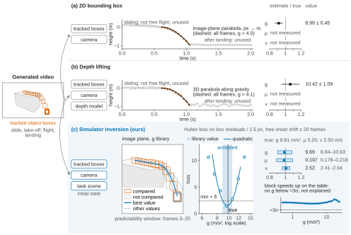

# PhyResponse

<p align="center">
<a href="https://huggingface.co/datasets/phy2/phydataset"></a>
<a href="https://huggingface.co/datasets/SunYat-senUniversity/PhyResponse"></a>
<a href="https://huggingface.co/datasets/SunYat-senUniversity/PhyResponse-Generations"></a>
<a href="https://github.com/Shuran-z/PhyResponse/releases"></a>
<br>
<a href="README_zh.md"></a>
<a href="docs/REPOSITORY_GUIDE.md"></a>
<a href="docs/DATASET_INTRODUCTION.md"></a>
<a href="annotation_site/README.md"></a>
<a href="catalog/active_core100_conditions.json"></a>

<a href="LICENSE"></a>
</p>


**Do image-to-video models follow the physics they are asked for?** PhyResponse gives a model the first frame of a simulated physical event and a prompt that states its physics: gravity, friction or initial speed. We measure the physics in each generated video by inverting the original simulator and compare it with the prompt.

## Results

10 image-to-video models on the Core100 tasks, each prompted in four ways, 3,680 videos in total with seed 0:

- **short**: one sentence on the event, then the parameter values;
- **medium**: the parameter values written into a natural description of the event;
- **detailed**: the medium prompt plus the initial layout of the scene;
- **concat**: the parameter values alone, in a fixed sentence pattern.

**V** compares each video with the reference continuation of its task, which shows the same scene with the prompted physics. **P** measures the physical parameters the video shows. Definitions are in [docs/METRICS.md](docs/METRICS.md).

<table>
<tr><th rowspan="2">Model</th><th colspan="6">V: visual and motion consistency</th><th colspan="3">P: physical parameters</th></tr>
<tr><th>ADE ratio&nbsp;↓</th><th>S-IoU&nbsp;↑</th><th>ST-IoU&nbsp;↑</th><th>PSNR&nbsp;↑</th><th>SSIM&nbsp;↑</th><th>Cam.&nbsp;drift&nbsp;↓</th><th>Explained&nbsp;↑</th><th>g&nbsp;err.&nbsp;↓</th><th>v&nbsp;err.&nbsp;↓</th></tr>
<tr><td>CogVideoX-1.5</td><td align="right">1.02</td><td align="right">0.037</td><td align="right">0.000</td><td align="right">22.7</td><td align="right">0.852</td><td align="right">38%</td><td align="right">32.0%</td><td align="right">84.2%</td><td align="right">–</td></tr>
<tr><td>Cosmos-Predict2</td><td align="right">1.11</td><td align="right">0.033</td><td align="right">0.002</td><td align="right">20.1</td><td align="right">0.832</td><td align="right">12%</td><td align="right">19.4%</td><td align="right">58.0%</td><td align="right">44.6%</td></tr>
<tr><td>Cosmos3-Nano</td><td align="right">1.40</td><td align="right">0.123</td><td align="right">0.002</td><td align="right">30.0</td><td align="right">0.938</td><td align="right">4%</td><td align="right">24.8%</td><td align="right">70.4%</td><td align="right">35.2%</td></tr>
<tr><td>HunyuanVideo-1.5</td><td align="right">1.55</td><td align="right">0.154</td><td align="right">0.010</td><td align="right">27.8</td><td align="right">0.938</td><td align="right">8%</td><td align="right">23.2%</td><td align="right">66.6%</td><td align="right">–</td></tr>
<tr><td>MiniMax-H3</td><td align="right">1.32</td><td align="right">0.263</td><td align="right">0.007</td><td align="right">30.2</td><td align="right">0.927</td><td align="right">20%</td><td align="right">26.8%</td><td align="right">65.3%</td><td align="right">36.0%</td></tr>
<tr><td>PhysAlign</td><td align="right">2.06</td><td align="right">0.181</td><td align="right">0.002</td><td align="right">30.4</td><td align="right">0.944</td><td align="right">0%</td><td align="right">18.7%</td><td align="right">83.7%</td><td align="right">59.0%</td></tr>
<tr><td>PhysRVG</td><td align="right">1.01</td><td align="right">0.016</td><td align="right">0.000</td><td align="right">32.1</td><td align="right">0.945</td><td align="right">6%</td><td align="right">29.4%</td><td align="right">83.7%</td><td align="right">–</td></tr>
<tr><td>VideoGPA</td><td align="right">1.37</td><td align="right">0.027</td><td align="right">0.002</td><td align="right">23.4</td><td align="right">0.860</td><td align="right">49%</td><td align="right">26.0%</td><td align="right">75.4%</td><td align="right">41.1%</td></tr>
<tr><td>Wan2.2-I2V-A14B</td><td align="right">1.54</td><td align="right">0.040</td><td align="right">0.003</td><td align="right">20.8</td><td align="right">0.698</td><td align="right">63%</td><td align="right">17.8%</td><td align="right">67.2%</td><td align="right">60.0%</td></tr>
<tr><td>Wan2.2-TI2V-5B</td><td align="right">1.10</td><td align="right">0.030</td><td align="right">0.002</td><td align="right">22.2</td><td align="right">0.838</td><td align="right">54%</td><td align="right">18.3%</td><td align="right">77.8%</td><td align="right">–</td></tr>
<tr><td><b>All models</b></td><td align="right">1.18</td><td align="right">0.056</td><td align="right">0.002</td><td align="right">26.6</td><td align="right">0.913</td><td align="right">25%</td><td align="right">23.5%</td><td align="right">71.2%</td><td align="right">49.3%</td></tr>
<tr><td><i>Physically correct video</i></td><td align="right">0.03</td><td align="right">0.950</td><td align="right">0.761</td><td align="right">38.0</td><td align="right">0.984</td><td align="right">–</td><td align="right">92.9%</td><td align="right">3.0%</td><td align="right">1.5%</td></tr>
<tr><td><i>Condition frame held still</i></td><td align="right">1.00</td><td align="right">0.000</td><td align="right">0.000</td><td align="right">37.8</td><td align="right">0.980</td><td align="right">–</td><td align="right">–</td><td align="right">–</td><td align="right">–</td></tr>
</table>

- **ADE ratio**: trajectory error of the tracked objects divided by that of a video in which nothing moves. Below 1 is closer to the reference than standing still.
- **S-IoU, ST-IoU**: whether motion happens at the right place, and at the right place and time, as defined in Physics-IQ.
- **PSNR, SSIM**: per frame against the reference continuation. A still condition frame scores almost as high as a physically correct video, so both measure appearance stability rather than physics.
- **Cam. drift**: share of videos whose camera moves by more than 2 % of the image diagonal.
- **Explained**: share of results whose motion some value of the parameter explains in the original simulator.
- **Error**: median |measured / prompted − 1| over the results that yield a value.
- *Italic rows*: the reference videos re-encoded in the generated formats, and the condition frame held still.

**Do the videos follow the prompted values?** Every video of a scene is read under the same reference clip, so the only systematic difference between two videos is the value in their prompts. A pair is concordant when the measured values keep the prompted order; chance is 0.5.

| Prompt type | g: concordant share | v: concordant share |
|---|---:|---:|
| short | 0.54 [0.34–0.74] (34/29) | 0.54 [0.41–0.66] (39/33) |
| medium | 0.36 [0.22–0.55] (14/25) | 0.68 [0.50–0.86] (36/17) |
| detailed | 0.46 [0.34–0.59] (24/28) | 0.45 [0.29–0.62] (23/28) |
| concat | 0.44 [0.28–0.64] (18/23) | 0.51 [0.37–0.66] (27/26) |

Share with its 95 % interval and the number of concordant/discordant pairs. No prompt type moves the measured physics with the prompted value clearly beyond chance. In the medium and detailed prompts the event sentence also changes with the value, so their pairs carry that difference too.

Results of the earlier 12-model collection: [docs/ARCHIVE.md](docs/ARCHIVE.md).

## Critical-boundary evaluation

Some events change their outcome at a parameter boundary: an object tips over or stays, slides or sticks. This module places samples at known distances on both sides of the reference boundary and checks whether the generated event is correct.

| Metric | Meaning |
|---|---|
| NearAcc | balanced accuracy close to the boundary |
| Distance-stratified accuracy | balanced accuracy per distance bin |
| PairAcc | both samples of a cross-boundary pair are correct |
| EventExact | the whole event chain matches |

[Core100 critical-boundary evaluation](docs/critical_boundary/CORE100_ACTUAL_PROMPT_BINDINGS_V5.md) provides 100 bound references, including 14 Near references and 13 cross-boundary pairs, with the author-selected actual submission text restored in v5. [15 changed inputs require new generation and annotation](benchmarks/core100_regeneration_v5_20261103/README.md). This version has a separate input and scoring namespace; the result tables below do not represent evaluation on these changed inputs.

`python -m physedit boundary` registers the samples, builds the generation manifests and scores them. `python -m physedit boundary-evaluate` adds quality screening, per-event judging and human review. Protocol: [docs/critical_boundary/CRITICAL_BOUNDARY_PROTOCOL.md](docs/critical_boundary/CRITICAL_BOUNDARY_PROTOCOL.md).

## Why simulator inversion

<p align="center"></p>

There are three ways to measure gravity, friction or speed from a single video:

- **2D bounding box** fits a parabola to the image-plane trajectory of the object's box.
- **Depth lifting** lifts the trajectory to 3D with a depth model and fits a parabola along gravity.
- **Simulator inversion**, ours, re-simulates the task's original scene at many parameter values and keeps the values whose rendered boxes match the video.

The two baselines fit a free-flight trajectory and estimate g. Simulator inversion is analysis by synthesis with a physics engine, as in [Galileo](https://proceedings.neurips.cc/paper_files/paper/2015/file/d09bf41544a3365a46c9077ebb5e35c3-Paper.pdf). Every generated video starts from a known simulated scene, so we replay that exact scene: contact, friction, rolling and collisions follow the same simulator as the reference, the same replay measures g, μ and v, each over its own library of values, and a motion that no parameter value reproduces is reported as not explained. The method is described in [docs/INVERSION.md](docs/INVERSION.md).

**Development set.** Simulated videos with known parameters, separate from Core100. Every method receives the same tracked boxes and the same camera.

| Method | g error | μ error | v error |
|---|---:|---:|---:|
| 2D bounding box | TBD | – | – |
| Depth lifting: DepthPro, Depth Anything V2, ZoeDepth, MoGe-2, UniDepthV2, VGGT | TBD | – | – |
| Simulator inversion, ours | TBD | TBD | TBD |

**Known-answer test.** The same pipeline runs on videos whose physics is known: the Core100 reference videos and their re-encodings in the formats of the generated videos.

| Videos with known physics | g error | μ error | v error | g τ | v τ |
|---|---:|---:|---:|---:|---:|
| Core100 reference videos | 2.0% | 2.0% | 0.8% | +1.00 | +1.00 |
| Re-encoded, 15 fps | 2.3% | 2.0% | 0.8% | +1.00 | +1.00 |
| Re-encoded, 30 fps, 121 frames | 2.4% | 2.7% | 0.7% | +1.00 | +1.00 |
| Re-encoded, 10 fps, 16 frames | 2.1% | 2.4% | 0.8% | +1.00 | +1.00 |

The uncertainty bands are calibrated to 95 % coverage on the reference videos. A generated result counts only where the same task in the same video format passes this test.

## Data and weights

| Resource | Content |
|---|---|
| [phy2/phydataset](https://huggingface.co/datasets/phy2/phydataset) | PhyDataset: simulated physical events with per-frame states, known conditions and prompts in English and Chinese; the Core100 tasks come from it |
| [SunYat-senUniversity/PhyResponse](https://huggingface.co/datasets/SunYat-senUniversity/PhyResponse) | Four-condition prompts of the reference videos |
| [SunYat-senUniversity/PhyResponse-Generations](https://huggingface.co/datasets/SunYat-senUniversity/PhyResponse-Generations) | Generated videos of 10 models on Core100 with four prompt types; the earlier 12-model collection is under `archive/` |

LoRA weights trained on PhyDataset, from the [Releases](https://github.com/Shuran-z/PhyResponse/releases):

| Base model | Language | Weights |
|---|---|---|
| CogVideoX1.5-5B-I2V | EN | [cogvideox1.5-5b-i2v-phydataset-en-lora-v1](https://github.com/Shuran-z/PhyResponse/releases/tag/cogvideox1.5-5b-i2v-phydataset-en-lora-v1) |
| Wan2.2-TI2V-5B | EN | [wan2.2-ti2v-5b-phydataset-en-lora-v1](https://github.com/Shuran-z/PhyResponse/releases/tag/wan2.2-ti2v-5b-phydataset-en-lora-v1) |
| Wan2.2-TI2V-5B | ZH | [wan2.2-ti2v-5b-phydataset-zh-lora-v1](https://github.com/Shuran-z/PhyResponse/releases/tag/wan2.2-ti2v-5b-phydataset-zh-lora-v1) |
| LTX-Video-2B | EN | [ltx-video-2b-phydataset-en-lora-v1](https://github.com/Shuran-z/PhyResponse/releases/tag/ltx-video-2b-phydataset-en-lora-v1) |
| LTX-Video-2B | ZH | [ltx-video-2b-phydataset-zh-lora-v1](https://github.com/Shuran-z/PhyResponse/releases/tag/ltx-video-2b-phydataset-zh-lora-v1) |

## Usage

```bash
pip install -e .
```

- Evaluate a model: [docs/EVALUATE.md](docs/EVALUATE.md)
- Generation runners of the evaluated models: [docs/phyediting/MODELS.md](docs/phyediting/MODELS.md)
- Critical-boundary module: [BOUNDARY_EVALUATION.md](BOUNDARY_EVALUATION.md)

## Repository

| Path | Content |
|---|---|
| `physprobe/` | Simulator inversion and the V and P metrics |
| `physedit/` | Generation runners and the critical-boundary module |
| `gravtrace/`, `scripts/` | 2D bounding box and depth lifting baselines, analysis scripts |
| `annotation_site/` | Human annotation, quality screening, per-event review and scoring bridge |
| `catalog/`, `benchmarks/` | Active reference pointers, frozen inputs and file hashes |
| `docs/` | Metrics, method and evaluation guide |

## License

MIT, see [LICENSE](LICENSE).
