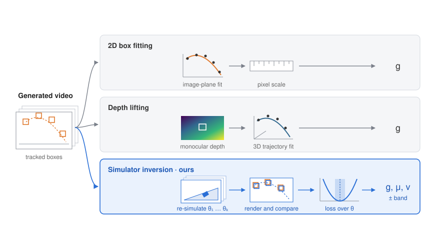

# PhysEdit

**图生视频模型能否按要求生成物理？** PhysEdit 给模型一段仿真物理事件的首帧，以及写明物理条件的提示词，包括重力、摩擦或初速度。我们用原始仿真器反演，测出每条生成视频里的物理参数，再和提示词比较。

[生成视频](https://huggingface.co/datasets/phy2/phy2-benchmark-generations) · [PhyDataset](https://huggingface.co/datasets/phy2/phydataset) · [LoRA 权重](#数据与权重) · [English](README.md)

## 结果

12 个图生视频模型，Core100 中的 97 个任务。每个任务有 3 种提示词写法、3 个随机种子，每个模型约 870 条视频。每条视频用两组指标评分：

- **V**：和该任务的参考续段比较；参考续段是同一场景在提示物理条件下的真实结果。
- **P**：测量视频表现出的物理参数。

定义见 [docs/METRICS_zh.md](docs/METRICS_zh.md)。

<table>
<tr><th rowspan="2">模型</th><th colspan="6">V：画面与运动一致性</th><th colspan="6">P：物理参数</th></tr>
<tr><th>ADE 比值&nbsp;↓</th><th>S-IoU&nbsp;↑</th><th>ST-IoU&nbsp;↑</th><th>PSNR&nbsp;↑</th><th>SSIM&nbsp;↑</th><th>镜头漂移&nbsp;↓</th><th>可解释率&nbsp;↑</th><th>g&nbsp;误差&nbsp;↓</th><th>μ&nbsp;误差&nbsp;↓</th><th>v&nbsp;误差&nbsp;↓</th><th>g&nbsp;τ&nbsp;↑</th><th>v&nbsp;τ&nbsp;↑</th></tr>
<tr><td>CogVideoX-1.5</td><td align="right">1.01</td><td align="right">0.060</td><td align="right">0.003</td><td align="right">24.6</td><td align="right">0.869</td><td align="right">11%</td><td align="right">34.2%</td><td align="right">60.6%</td><td align="right">34.6%</td><td align="right">61.9%</td><td align="right">+0.17</td><td align="right">–</td></tr>
<tr><td>Cosmos-Predict2</td><td align="right">1.04</td><td align="right">0.087</td><td align="right">0.004</td><td align="right">24.5</td><td align="right">0.842</td><td align="right">28%</td><td align="right">31.7%</td><td align="right">60.6%</td><td align="right">34.6%</td><td align="right">45.7%</td><td align="right">+0.56</td><td align="right">+0.62</td></tr>
<tr><td>Cosmos3-Nano</td><td align="right">1.07</td><td align="right">0.185</td><td align="right">0.010</td><td align="right">30.6</td><td align="right">0.933</td><td align="right">4%</td><td align="right">35.0%</td><td align="right">79.5%</td><td align="right">16.2%</td><td align="right">52.7%</td><td align="right">+0.37</td><td align="right">-0.05</td></tr>
<tr><td>DynamiCrafter</td><td align="right">2.09</td><td align="right">0.021</td><td align="right">0.003</td><td align="right">18.8</td><td align="right">0.606</td><td align="right">86%</td><td align="right">19.7%</td><td align="right">79.4%</td><td align="right">39.4%</td><td align="right">21.1%</td><td align="right">+0.33</td><td align="right">+0.24</td></tr>
<tr><td>HunyuanVideo-1.5</td><td align="right">1.26</td><td align="right">0.199</td><td align="right">0.011</td><td align="right">27.9</td><td align="right">0.926</td><td align="right">5%</td><td align="right">20.1%</td><td align="right">60.6%</td><td align="right">34.6%</td><td align="right">61.3%</td><td align="right">+0.95</td><td align="right">+0.64</td></tr>
<tr><td>LTX-Video-2B</td><td align="right">1.03</td><td align="right">0.068</td><td align="right">0.003</td><td align="right">26.5</td><td align="right">0.846</td><td align="right">42%</td><td align="right">41.0%</td><td align="right">60.5%</td><td align="right">33.0%</td><td align="right">–</td><td align="right">+0.80</td><td align="right">–</td></tr>
<tr><td>MiniMax-H3</td><td align="right">1.46</td><td align="right">0.169</td><td align="right">0.009</td><td align="right">23.6</td><td align="right">0.736</td><td align="right">57%</td><td align="right">25.9%</td><td align="right">66.7%</td><td align="right">48.6%</td><td align="right">22.5%</td><td align="right">+0.78</td><td align="right">+0.76</td></tr>
<tr><td>PhysAlign</td><td align="right">1.67</td><td align="right">0.156</td><td align="right">0.004</td><td align="right">29.9</td><td align="right">0.934</td><td align="right">1%</td><td align="right">22.6%</td><td align="right">70.3%</td><td align="right">34.7%</td><td align="right">65.9%</td><td align="right">+0.46</td><td align="right">+1.00</td></tr>
<tr><td>PhysRVG</td><td align="right">1.01</td><td align="right">0.027</td><td align="right">0.001</td><td align="right">29.6</td><td align="right">0.927</td><td align="right">7%</td><td align="right">47.5%</td><td align="right">83.7%</td><td align="right">34.6%</td><td align="right">–</td><td align="right">+0.69</td><td align="right">–</td></tr>
<tr><td>VideoGPA</td><td align="right">1.08</td><td align="right">0.043</td><td align="right">0.004</td><td align="right">22.2</td><td align="right">0.801</td><td align="right">65%</td><td align="right">29.6%</td><td align="right">79.5%</td><td align="right">34.6%</td><td align="right">55.6%</td><td align="right">+0.43</td><td align="right">–</td></tr>
<tr><td>Wan2.2-I2V-A14B</td><td align="right">1.67</td><td align="right">0.081</td><td align="right">0.005</td><td align="right">22.1</td><td align="right">0.723</td><td align="right">60%</td><td align="right">22.1%</td><td align="right">83.4%</td><td align="right">34.7%</td><td align="right">12.3%</td><td align="right">+0.92</td><td align="right">+0.75</td></tr>
<tr><td>Wan2.2-TI2V-5B</td><td align="right">1.04</td><td align="right">0.044</td><td align="right">0.003</td><td align="right">24.4</td><td align="right">0.832</td><td align="right">54%</td><td align="right">37.0%</td><td align="right">79.6%</td><td align="right">34.6%</td><td align="right">50.6%</td><td align="right">+0.43</td><td align="right">–</td></tr>
<tr><td><b>全部模型</b></td><td align="right"></td><td align="right"></td><td align="right"></td><td align="right"></td><td align="right"></td><td align="right"></td><td align="right">30.6%</td><td align="right">71.8%</td><td align="right">34.6%</td><td align="right">32.6%</td><td align="right">+0.63</td><td align="right">+0.48</td></tr>
<tr><td><i>物理正确的视频</i></td><td align="right">0.02</td><td align="right">0.962</td><td align="right">0.891</td><td align="right">37.7</td><td align="right">0.978</td><td align="right">–</td><td align="right">–</td><td align="right">2.4%</td><td align="right">2.7%</td><td align="right">0.7%</td><td align="right">+1.00</td><td align="right">+1.00</td></tr>
<tr><td><i>条件帧静止不动</i></td><td align="right">1.00</td><td align="right">0.000</td><td align="right">0.000</td><td align="right">37.0</td><td align="right">0.976</td><td align="right">–</td><td align="right">–</td><td align="right">–</td><td align="right">–</td><td align="right">–</td><td align="right">–</td><td align="right">–</td></tr>
</table>

- **ADE 比值**：被跟踪物体的轨迹误差，除以画面完全不动时的误差。小于 1 才说明比不动更接近参考。
- **S-IoU、ST-IoU**：运动发生的位置是否对得上，以及位置和时间是否都对得上，定义同 Physics-IQ。
- **PSNR、SSIM**：逐帧和参考续段比较。条件帧静止不动就有 37.0 dB，高于所有模型，所以这两项衡量的是画面稳定，不是物理。
- **镜头漂移**：镜头移动超过画面对角线 2% 的视频占比。
- **可解释率**：在原始仿真器里，运动能被该参数某个取值解释的结果占比。
- **误差**：给出数值的结果中，|测得值 / 提示值 − 1| 的中位数。
- **τ**：同一任务的视频之间，提示值和测得值的 Kendall τ。全部模型的 95% 区间：g 为 +0.46 到 +0.78，v 为 +0.10 到 +0.73。
- *斜体两行*：参考视频按 30 fps 重编码后的物理正确视频，以及条件帧静止不动。

## 临界边界评测

有些事件在参数越过某个边界时结果会改变，例如物体倒或不倒、滑动或静止。这个模块在参考边界两侧已知距离处放置样本，检查生成的事件是否正确。

| 指标 | 含义 |
|---|---|
| NearAcc | 靠近边界时的平衡准确率 |
| 距离分层准确率 | 按到边界的距离分组的平衡准确率 |
| PairAcc | 跨边界的一对样本都正确 |
| EventExact | 整条事件链完全一致 |

`python -m physedit boundary` 负责样本登记、生成清单与评分；`python -m physedit boundary-evaluate` 负责质量筛查、逐事件判读和人工复核。协议见 [docs/critical_boundary/CRITICAL_BOUNDARY_PROTOCOL.md](docs/critical_boundary/CRITICAL_BOUNDARY_PROTOCOL.md)。

## 为什么用仿真器反演

<p align="center"></p>

从一条视频测量重力、摩擦或速度，有三类做法：

- **2D 包围盒**：对物体框在画面上的轨迹拟合抛物线。
- **深度提升**：用深度模型把轨迹提升到 3D，再沿重力方向拟合抛物线。
- **仿真器反演**，即本文方法：在任务的原始场景里用很多参数值重新仿真，保留渲染出的物体框和视频对得上的取值。

两种对比方法都拟合自由飞行轨迹，估计 g。仿真器反演是借助物理引擎的分析—合成方法，和 [Galileo](https://proceedings.neurips.cc/paper_files/paper/2015/file/d09bf41544a3365a46c9077ebb5e35c3-Paper.pdf) 同类。每条生成视频都从一个已知的仿真场景出发，我们直接重放这个场景：接触、摩擦、滚动和碰撞都按参考视频的仿真处理，一次拟合得到 g、μ、v；没有任何取值能复现的运动记为无法解释。方法见 [docs/INVERSION_zh.md](docs/INVERSION_zh.md)。

**开发集**：已知参数的仿真视频，不属于 Core100。三种方法使用同样的跟踪框和同样的相机。

| 方法 | g 误差 | μ 误差 | v 误差 |
|---|---:|---:|---:|
| 2D 包围盒 | TBD | – | – |
| 深度提升：DepthPro, Depth Anything V2, ZoeDepth, MoGe-2, UniDepthV2, VGGT | TBD | – | – |
| 仿真器反演，本文 | TBD | TBD | TBD |

**已知答案测试**：同一流程跑在物理已知的视频上，包括 Core100 参考视频，以及按生成视频格式重编码的参考视频。

| 物理已知的视频 | g 误差 | μ 误差 | v 误差 | g τ | v τ |
|---|---:|---:|---:|---:|---:|
| Core100 参考视频 | 2.0% | 2.0% | 0.8% | +1.00 | +1.00 |
| 重编码，15 fps | 2.3% | 2.0% | 0.8% | +1.00 | +1.00 |
| 重编码，30 fps、121 帧 | 2.4% | 2.7% | 0.7% | +1.00 | +1.00 |
| 重编码，10 fps、16 帧 | 2.1% | 2.4% | 0.8% | +1.00 | +1.00 |

不确定带在参考视频上校准到 95% 覆盖率。只有同一任务、同一视频格式通过这项测试，生成视频的结果才计入统计。

## 数据与权重

| 资源 | 内容 |
|---|---|
| [phy2/phy2-benchmark-generations](https://huggingface.co/datasets/phy2/phy2-benchmark-generations) | 12 个模型在 Core100 上的生成视频 |
| [phy2/phydataset](https://huggingface.co/datasets/phy2/phydataset) | PhyDataset：仿真物理事件，含逐帧状态、已知条件和中英文提示词；Core100 的任务取自其中 |

用 PhyDataset 训练的 LoRA 权重，发布在 [Releases](https://github.com/Shuran-z/PhysEdit/releases)：

| 基础模型 | 语言 | 权重 |
|---|---|---|
| CogVideoX1.5-5B-I2V | 英文 | [cogvideox1.5-5b-i2v-phydataset-en-lora-v1](https://github.com/Shuran-z/PhysEdit/releases/tag/cogvideox1.5-5b-i2v-phydataset-en-lora-v1) |
| Wan2.2-TI2V-5B | 英文 | [wan2.2-ti2v-5b-phydataset-en-lora-v1](https://github.com/Shuran-z/PhysEdit/releases/tag/wan2.2-ti2v-5b-phydataset-en-lora-v1) |
| Wan2.2-TI2V-5B | 中文 | [wan2.2-ti2v-5b-phydataset-zh-lora-v1](https://github.com/Shuran-z/PhysEdit/releases/tag/wan2.2-ti2v-5b-phydataset-zh-lora-v1) |
| LTX-Video-2B | 英文 | [ltx-video-2b-phydataset-en-lora-v1](https://github.com/Shuran-z/PhysEdit/releases/tag/ltx-video-2b-phydataset-en-lora-v1) |
| LTX-Video-2B | 中文 | [ltx-video-2b-phydataset-zh-lora-v1](https://github.com/Shuran-z/PhysEdit/releases/tag/ltx-video-2b-phydataset-zh-lora-v1) |

## 使用

```bash
pip install -e .
```

- 评测一个模型：[docs/EVALUATE_zh.md](docs/EVALUATE_zh.md)
- 被评测模型的生成配置：[docs/phyediting/MODELS.md](docs/phyediting/MODELS.md)
- 临界边界模块：[BOUNDARY_EVALUATION.md](BOUNDARY_EVALUATION.md)

## 仓库结构

| 路径 | 内容 |
|---|---|
| `physprobe/` | 仿真器反演与 V、P 指标 |
| `physedit/` | 生成模型运行与临界边界模块 |
| `gravtrace/`、`scripts/` | 2D 包围盒与深度提升对比方法、分析脚本 |
| `docs/` | 指标、方法与评测指南 |

## 许可

MIT，见 [LICENSE](LICENSE)。
