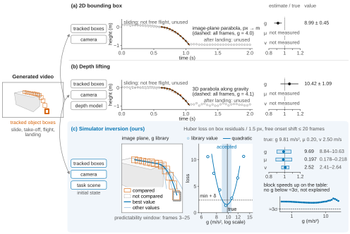

# PhyResponse

<p align="center">
<a href="https://huggingface.co/datasets/phy2/phydataset"></a>
<a href="https://huggingface.co/datasets/SunYat-senUniversity/PhyResponse"></a>
<a href="https://huggingface.co/datasets/SunYat-senUniversity/PhyResponse-Generations"></a>
<a href="https://github.com/Shuran-z/PhyResponse/releases"></a>
<br>
<a href="README.md"></a>
<a href="docs/REPOSITORY_GUIDE.md"></a>
<a href="docs/DATASET_INTRODUCTION.md"></a>
<a href="annotation_site/README.md"></a>
<a href="catalog/active_core100_conditions.json"></a>

<a href="LICENSE"></a>
</p>


**图生视频模型能否按要求生成物理？** PhyResponse 给模型一段仿真物理事件的首帧，以及写明物理条件的提示词，包括重力、摩擦或初速度。我们用原始仿真器反演，测出每条生成视频里的物理参数，再和提示词比较。

## 结果

10 个图生视频模型，Core100 任务，每个任务用四种提示词，随机种子 0，共 3,680 条视频：

- **short**：一句话描述事件，后接参数值；
- **medium**：把参数值写进事件的自然描述；
- **detailed**：medium 加上场景的初始布局；
- **concat**：只列参数值，用固定句式。

**V** 把每条视频和该任务的参考续段比较，参考续段是同一场景在提示物理条件下的真实结果。**P** 测量视频表现出的物理参数。定义见 [docs/METRICS_zh.md](docs/METRICS_zh.md)。

<table>
<tr><th rowspan="2">模型</th><th colspan="6">V：画面与运动一致性</th><th colspan="3">P：物理参数</th></tr>
<tr><th>ADE 比值&nbsp;↓</th><th>S-IoU&nbsp;↑</th><th>ST-IoU&nbsp;↑</th><th>PSNR&nbsp;↑</th><th>SSIM&nbsp;↑</th><th>镜头漂移&nbsp;↓</th><th>可解释率&nbsp;↑</th><th>g&nbsp;误差&nbsp;↓</th><th>v&nbsp;误差&nbsp;↓</th></tr>
<tr><td>CogVideoX-1.5</td><td align="right">1.02</td><td align="right">0.037</td><td align="right">0.000</td><td align="right">22.7</td><td align="right">0.852</td><td align="right">38%</td><td align="right">31.9%</td><td align="right">84.2%</td><td align="right">–</td></tr>
<tr><td>Cosmos-Predict2</td><td align="right">1.11</td><td align="right">0.033</td><td align="right">0.002</td><td align="right">20.1</td><td align="right">0.832</td><td align="right">12%</td><td align="right">19.3%</td><td align="right">58.0%</td><td align="right">44.6%</td></tr>
<tr><td>Cosmos3-Nano</td><td align="right">1.40</td><td align="right">0.123</td><td align="right">0.002</td><td align="right">30.0</td><td align="right">0.938</td><td align="right">4%</td><td align="right">24.6%</td><td align="right">70.4%</td><td align="right">35.2%</td></tr>
<tr><td>HunyuanVideo-1.5</td><td align="right">1.55</td><td align="right">0.154</td><td align="right">0.010</td><td align="right">27.8</td><td align="right">0.938</td><td align="right">8%</td><td align="right">23.2%</td><td align="right">66.6%</td><td align="right">–</td></tr>
<tr><td>MiniMax-H3</td><td align="right">1.32</td><td align="right">0.263</td><td align="right">0.007</td><td align="right">30.2</td><td align="right">0.927</td><td align="right">20%</td><td align="right">26.8%</td><td align="right">65.3%</td><td align="right">36.0%</td></tr>
<tr><td>PhysAlign</td><td align="right">2.06</td><td align="right">0.181</td><td align="right">0.002</td><td align="right">30.4</td><td align="right">0.944</td><td align="right">0%</td><td align="right">18.7%</td><td align="right">83.7%</td><td align="right">59.0%</td></tr>
<tr><td>PhysRVG</td><td align="right">1.01</td><td align="right">0.016</td><td align="right">0.000</td><td align="right">32.1</td><td align="right">0.945</td><td align="right">6%</td><td align="right">29.0%</td><td align="right">83.7%</td><td align="right">–</td></tr>
<tr><td>VideoGPA</td><td align="right">1.37</td><td align="right">0.027</td><td align="right">0.002</td><td align="right">23.4</td><td align="right">0.860</td><td align="right">49%</td><td align="right">26.0%</td><td align="right">75.4%</td><td align="right">41.1%</td></tr>
<tr><td>Wan2.2-I2V-A14B</td><td align="right">1.54</td><td align="right">0.040</td><td align="right">0.003</td><td align="right">20.8</td><td align="right">0.698</td><td align="right">63%</td><td align="right">17.8%</td><td align="right">67.2%</td><td align="right">60.0%</td></tr>
<tr><td>Wan2.2-TI2V-5B</td><td align="right">1.10</td><td align="right">0.030</td><td align="right">0.002</td><td align="right">22.2</td><td align="right">0.838</td><td align="right">54%</td><td align="right">18.3%</td><td align="right">77.8%</td><td align="right">–</td></tr>
<tr><td><b>全部模型</b></td><td align="right">1.18</td><td align="right">0.056</td><td align="right">0.002</td><td align="right">26.6</td><td align="right">0.913</td><td align="right">25%</td><td align="right">23.4%</td><td align="right">71.2%</td><td align="right">49.3%</td></tr>
<tr><td><i>物理正确的视频</i></td><td align="right">0.03</td><td align="right">0.950</td><td align="right">0.761</td><td align="right">38.0</td><td align="right">0.984</td><td align="right">–</td><td align="right">92.9%</td><td align="right">3.0%</td><td align="right">1.5%</td></tr>
<tr><td><i>条件帧静止不动</i></td><td align="right">1.00</td><td align="right">0.000</td><td align="right">0.000</td><td align="right">37.8</td><td align="right">0.980</td><td align="right">–</td><td align="right">–</td><td align="right">–</td><td align="right">–</td></tr>
</table>

- **ADE 比值**：被跟踪物体的轨迹误差除以一段静止视频的轨迹误差。小于 1 表示比静止更接近参考。
- **S-IoU、ST-IoU**：运动是否出现在正确的位置，以及正确的位置和时间，定义同 Physics-IQ。
- **PSNR、SSIM**：逐帧和参考续段比较。静止的条件帧几乎和物理正确的视频一样高，所以这两项衡量的是画面稳定，而不是物理。
- **镜头漂移**：镜头移动超过画面对角线 2% 的视频占比。
- **可解释率**：在原始仿真器里，有某个参数取值能解释其运动的结果占比。
- **误差**：给出数值的结果中，|测量值 / 提示值 − 1| 的中位数。
- *斜体两行*：参考视频按生成格式重编码后的物理正确视频，以及条件帧静止不动。

**视频是否随提示的数值变化？** 同一场景的所有视频都在同一个参考片段下读数，两条视频之间唯一系统性的差别就是提示里的数值。测量值保持提示顺序的一对视频记为一致；随机水平为 0.5。

| 提示词 | g：一致对占比 | v：一致对占比 |
|---|---:|---:|
| short | 0.54 [0.34–0.74] (34/29) | 0.54 [0.41–0.66] (39/33) |
| medium | 0.36 [0.22–0.55] (14/25) | 0.68 [0.50–0.86] (36/17) |
| detailed | 0.46 [0.34–0.59] (24/28) | 0.45 [0.29–0.62] (23/28) |
| concat | 0.44 [0.28–0.64] (18/23) | 0.51 [0.37–0.66] (27/26) |

占比后为 95% 区间及一致/不一致的对数。没有哪种提示词能让测出的物理量随提示数值变化到超出随机水平。medium 和 detailed 提示中，事件句也随数值改变，这两组的对比同时包含这部分差别。

早先 12 个模型的结果见 [docs/ARCHIVE_zh.md](docs/ARCHIVE_zh.md)。

## 临界边界评测

有些事件在参数越过某个边界时结果会改变，例如物体倒或不倒、滑动或静止。这个模块在参考边界两侧已知距离处放置样本，检查生成的事件是否正确。

| 指标 | 含义 |
|---|---|
| NearAcc | 靠近边界时的平衡准确率 |
| 距离分层准确率 | 按到边界的距离分组的平衡准确率 |
| PairAcc | 跨边界的一对样本都正确 |
| EventExact | 整条事件链完全一致 |

`python -m physedit boundary` 负责样本登记、生成清单与评分；`python -m physedit boundary-evaluate` 负责质量筛查、逐事件判读和人工复核。协议见 [docs/critical_boundary/CRITICAL_BOUNDARY_PROTOCOL.md](docs/critical_boundary/CRITICAL_BOUNDARY_PROTOCOL.md)。

## 为什么用仿真器反演

<p align="center"></p>

从一条视频测量重力、摩擦或速度，有三类做法：

- **2D 包围盒**：对物体框在画面上的轨迹拟合抛物线。
- **深度提升**：用深度模型把轨迹提升到 3D，再沿重力方向拟合抛物线。
- **仿真器反演**，即本文方法：在任务的原始场景里用很多参数值重新仿真，保留渲染出的物体框和视频对得上的取值。

两种对比方法都拟合自由飞行轨迹，估计 g。仿真器反演是借助物理引擎的分析—合成方法，和 [Galileo](https://proceedings.neurips.cc/paper_files/paper/2015/file/d09bf41544a3365a46c9077ebb5e35c3-Paper.pdf) 同类。每条生成视频都从一个已知的仿真场景出发，我们直接重放这个场景：接触、摩擦、滚动和碰撞都按参考视频的仿真处理，同一套重放分别在各自的取值库上测出 g、μ、v；没有任何取值能复现的运动记为无法解释。方法见 [docs/INVERSION_zh.md](docs/INVERSION_zh.md)。

**开发集**：已知参数的仿真视频，不属于 Core100。三种方法使用同样的跟踪框和同样的相机。

| 方法 | g 误差 | μ 误差 | v 误差 |
|---|---:|---:|---:|
| 2D 包围盒 | TBD | – | – |
| 深度提升：DepthPro, Depth Anything V2, ZoeDepth, MoGe-2, UniDepthV2, VGGT | TBD | – | – |
| 仿真器反演，本文 | TBD | TBD | TBD |

**已知答案测试**：同一流程跑在物理已知的视频上，包括 Core100 参考视频，以及按生成视频格式重编码的参考视频。

| 物理已知的视频 | g 误差 | μ 误差 | v 误差 | g τ | v τ |
|---|---:|---:|---:|---:|---:|
| Core100 参考视频 | 2.0% | 2.0% | 0.8% | +1.00 | +1.00 |
| 重编码，15 fps | 2.3% | 2.0% | 0.8% | +1.00 | +1.00 |
| 重编码，30 fps、121 帧 | 2.4% | 2.7% | 0.7% | +1.00 | +1.00 |
| 重编码，10 fps、16 帧 | 2.1% | 2.4% | 0.8% | +1.00 | +1.00 |

不确定带在参考视频上校准到 95% 覆盖率。只有同一任务、同一视频格式通过这项测试，生成视频的结果才计入统计。

## 数据与权重

| 资源 | 内容 |
|---|---|
| [phy2/phydataset](https://huggingface.co/datasets/phy2/phydataset) | PhyDataset：仿真物理事件，含逐帧状态、已知条件和中英文提示词；Core100 的任务取自其中 |
| [SunYat-senUniversity/PhyResponse](https://huggingface.co/datasets/SunYat-senUniversity/PhyResponse) | 参考视频的四组条件提示词 |
| [SunYat-senUniversity/PhyResponse-Generations](https://huggingface.co/datasets/SunYat-senUniversity/PhyResponse-Generations) | 10 个模型在 Core100 上的生成视频，四组提示词；早先 12 个模型的视频在 `archive/` 下 |

用 PhyDataset 训练的 LoRA 权重，发布在 [Releases](https://github.com/Shuran-z/PhyResponse/releases)：

| 基础模型 | 语言 | 权重 |
|---|---|---|
| CogVideoX1.5-5B-I2V | 英文 | [cogvideox1.5-5b-i2v-phydataset-en-lora-v1](https://github.com/Shuran-z/PhyResponse/releases/tag/cogvideox1.5-5b-i2v-phydataset-en-lora-v1) |
| Wan2.2-TI2V-5B | 英文 | [wan2.2-ti2v-5b-phydataset-en-lora-v1](https://github.com/Shuran-z/PhyResponse/releases/tag/wan2.2-ti2v-5b-phydataset-en-lora-v1) |
| Wan2.2-TI2V-5B | 中文 | [wan2.2-ti2v-5b-phydataset-zh-lora-v1](https://github.com/Shuran-z/PhyResponse/releases/tag/wan2.2-ti2v-5b-phydataset-zh-lora-v1) |
| LTX-Video-2B | 英文 | [ltx-video-2b-phydataset-en-lora-v1](https://github.com/Shuran-z/PhyResponse/releases/tag/ltx-video-2b-phydataset-en-lora-v1) |
| LTX-Video-2B | 中文 | [ltx-video-2b-phydataset-zh-lora-v1](https://github.com/Shuran-z/PhyResponse/releases/tag/ltx-video-2b-phydataset-zh-lora-v1) |

## 使用

```bash
pip install -e .
```

- 评测一个模型：[docs/EVALUATE_zh.md](docs/EVALUATE_zh.md)
- 被评测模型的生成配置：[docs/phyediting/MODELS.md](docs/phyediting/MODELS.md)
- 临界边界模块：[BOUNDARY_EVALUATION.md](BOUNDARY_EVALUATION.md)

## 仓库结构

| 路径 | 内容 |
|---|---|
| `physprobe/` | 仿真器反演与 V、P 指标 |
| `physedit/` | 生成模型运行与临界边界模块 |
| `gravtrace/`、`scripts/` | 2D 包围盒与深度提升对比方法、分析脚本 |
| `annotation_site/` | 人工标注、质量筛查、逐事件复核与评分桥 |
| `catalog/`、`benchmarks/` | 当前参考入口、冻结输入及文件哈希 |
| `docs/` | 指标、方法与评测指南 |

## 许可

MIT，见 [LICENSE](LICENSE)。
