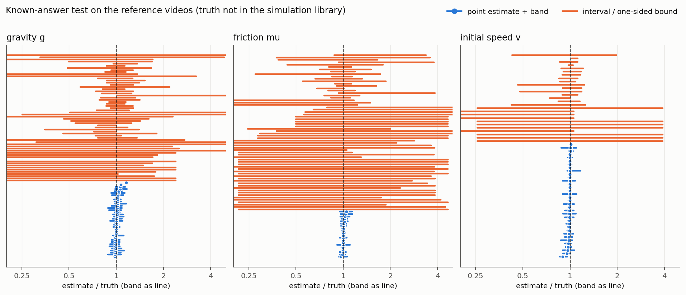
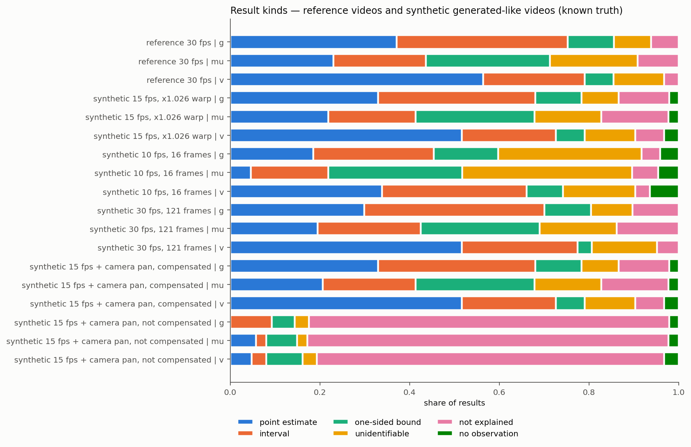
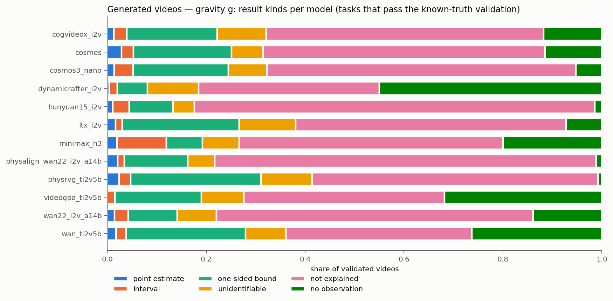
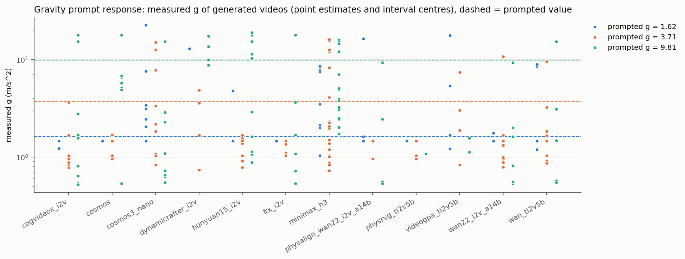

# PhysProbe 评测验收报告：Core100 物理参数反演

日期：2026-10-26 · 代码：`physprobe/inversion/`（分支 `physprobe-inversion`）· 运行手册：[physprobe/inversion/README.md](../../physprobe/inversion/README.md)

## 1. 结论

**评测做什么。**对 PhysEdit Core100 的每条视频（参考视频，或以第 5 帧为条件生成的视频），在其他条件全部已知的前提下，分别测量三个物理参数：
- 重力 g；
- 主接触面摩擦 μ；
- 初速度 v，只对有指定速度的 62 条任务。

做法是把视频里物体的运动，和作者原始 Genesis 场景在不同参数下的仿真逐帧比较。输出分以下几类：
- 点估计；
- 校准过的不确定区间；
- 单侧界；
- 不可辨识；
- 无法解释（任何参数值都解释不了视频里的运动）；
- 无观测（物体在窗口内大部分时间无法定位）。

**范围。**Core100 共 100 条任务，评测其中 97 条：T06_C04 用 Isaac 仿真（其余 99 条是 Genesis）；T07_C05、T09_C05 的参考视频里物体始终静止（书停在斜面上、书堆不倒），可预测窗口内没有运动可以反演。

**准确性。**在 97 条参考视频上做已知答案测试，真值不在仿真库里：

| 参数 | 点估计 | 点估计误差中位数 | 90 分位 | 测量值(点估计 + 区间) | 测量值误差中位数 | 测量值 10% 以内 | 真值落在不确定带内 |
|---|---|---|---|---|---|---|---|
| g | 36/97 | 1.40% | 6.1% | 73/97 | 2.0% | 90% | 87/96(90.6%) |
| μ | 20/87 | 0.55% | 3.6% | 38/87 | 2.0% | 82% | 79/86(91.9%) |
| v | 35/62 | 0.76% | 2.7% | 49/62 | 0.8% | 92% | 59/62(95.2%) |

- 每组结果都给一个精确的最佳拟合值和它的框残差(像素)。点估计和区间的最佳值可以直接当测量值用(3.6 节);单侧界、不可辨识的最佳值没有意义,只报告界或"不可辨识"。
- 不确定带使用理论噪声阈值(σ = 1.5 px,损失差 δ = 1),在 240 组参考结果上覆盖率 95.4%,不需要做经验放大。
- 没有给出测量值的情况,都给出了如实的单侧界或"不可辨识"。这些多数是物理上确实测不准的情形:可预测窗口不到 0.3 秒、参数几乎不影响可见运动、真值附近存在分叉。

**生成视频路径同样准确。**把参考视频改造成"像生成视频"的合成视频,真值已知,走完整的生成视频流程:
- 15 fps、81 帧,外加 2.6% 的横向缩放:点估计误差中位数 g 1.28%、μ 0.86%、v 0.72%;测量值 g 66/97、误差中位数 2.3%;
- 30 fps、121 帧:g 1.73%、μ 0.76%、v 0.54%;测量值 g 68/97、2.4%;
- 10 fps、16 帧:g 1.31%、v 0.47%,但 μ 只有 4 个点估计,g 的测量值 44/97;
- 再叠加已知的镜头运动并做补偿:g 1.31%,和不加镜头运动时几乎一样;不补偿则 78/97 判为"无法解释"。

帧率换算、画面配准和相机运动补偿都没有引入可见的额外误差。

**合理性。**生成视频没有真值,用四类证据来检查:
- **跟踪噪声**:除 DynamiCrafter 外,生成视频上 SAM 框的逐帧抖动和真值视频同一量级(90 分位 ≤ 1.8 px)。
- **"无法解释"的含义**:它对应看得见的运动偏离:
  - 该动的不动,35%;
  - 动得不够,19%;
  - 轨迹不对,21%;
  - 动得过多,26%。
  
  其中 77.5% 的视频镜头配准完全正常,不是相机补偿的问题。
- **人工判读**:133 张叠加图。
  - "无法解释"的 43 张里,91% 确认是模型的物理错误或场景崩坏,0 张是跟踪失败;
  - 其余 90 张里,74% 合理,7% 拿不准,19% 不合理。不合理的主要是场景崩坏,其中一部分已被覆盖规则(D31)纠正,剩余约 11%,是这类指标的固有局限。
- **敏感性**:噪声容差加倍,不能评测的比例从 69% 降到 45%,但按它的模型排序基本稳定(ρ 0.83);v 的参数响应稳定(+0.48 → +0.43),g 的参数响应对容差敏感(+0.66 → +0.17),要谨慎解读(4.4 节)。

另外,真值视频本身也有少数(任务, 参数)给出"无法解释"(遮挡、叠放的书等),生成视频在这些地方不计分(真值验证门,挡掉 3,141 组,即 12.0%)。

**对生成视频的发现。**12 个模型、10,295 条视频、22,973 组计入统计的结果。按两类指标报告(口径见第 5 节):

1. **可评测性。**给出数值(点估计或区间)的 3.2%,单侧界 19.6%,不可辨识 7.9%;不能评测的占 69.2%,其中无法解释 54.5%、无观测 14.7%。各模型不能评测的比例在 53.5%(PhysRVG)到 80.7%(Hunyuan)之间。这个比例能否作为物理合理性的指标,要看它和人工打分的相关性(打分正在标注,数据到了再算)。
2. **有数值的结果:反演误差和参数响应。**

| | g 误差中位数 | μ 误差中位数 | v 误差中位数 | g 响应 τ | v 响应 τ |
|---|---|---|---|---|---|
| 真值视频(参考 + 三种合成格式) | 2.0–2.4% | 2.0–2.7% | 0.7–0.8% | +1.00 | +1.00 |
| 生成视频(12 个模型合计) | 72.6%(n = 400) | 34.7%(n = 248) | 32.8%(n = 98) | +0.66 [+0.48, +0.80] | +0.48 [+0.09, +0.72] |

误差是测量值相对提示值的偏差;响应是同一模型、同一任务内提示值不同的视频之间,测量值的先后是否和提示一致(Kendall τ,单侧界也算,方括号是 95% 区间)。测量工具在真值视频上能完全分辨提示的 g 和 v;生成视频对 g、v 的提示有方向正确的响应,但幅度差得很远。按模型拆开后每个模型只有 1–7 组任务,τ 的区间很宽,不做模型间的细排;g 的响应对容差敏感(σ 加倍后 +0.17,4.4 节),v 的响应稳定。

系统性的偏向是:物体滑得比提示的少(μ 偏大)、动得比提示的慢(v 偏小)。

**速度。**
- 仿真库每个任务建一次,所有生成视频共用:11,570 条仿真(原始 8,305 条,按观测精度加密补 3,265 条);单张 H100 加 MPS 每分钟 4–10 条,取决于任务。
- 10,295 条生成视频的 SAM 3.1 跟踪合计 94.96 GPU·小时;每条中位数 25.4 秒,其中 H100 15.1 秒、A800 20.0 秒、3090 44.0 秒。
- 反演:全量重评测(参考、合成、生成视频,加真值验证门、汇总、运动检查和图表)在 h100-1 上 10 个进程约 55 分钟(同时有仿真在跑)。

## 2. 方法(对全部任务统一)

1. **仿真库。**每个(任务, 参数)建一个库,仿真用作者原始渲染脚本做纯物理重放,保持原始的 32 位设置。
   - g:绝对对数网格 0.5–25 m/s²,相邻比 1.12。
   - μ、v:真值 × 1.15^k / 1.12^k,另补两个半步。真值本身不进库,这样已知答案测试才是公平的。
   - 分叉区间再二分加密:相邻取值相差 ≥ 3%,而且两条轨迹差异超过运动幅度一半的地方,补上中点。
   - 按观测精度加密(D36):相邻两个取值的投影轨迹在可预测窗口内相差超过 4.5 px(且不超过 20 px,更大的是分叉,加密不收敛),补几何中点。只看仿真、不看真值。
   - 合计 254 个库、11,570 条仿真。每条只算到最后一个可预测窗口结束再加 31 帧。
2. **可预测窗口。**每个物体只在仿真本身能复现的帧段内参与比较。判据是:
   - 真值的多次重复之间、真值与记录之间,差异都小于 1.5 px;
   - 参数做 ±1e-4 扰动时,二阶差分也小于 1.5 px。
   
   所有库取值都用同一个窗口来比较。
3. **观测。**用 SAM 3.1(`sam3.1_multiplex.pt`)跟踪:
   - 一条视频里所有非固定物体在一次会话中联合跟踪;
   - 提示框是条件帧上物体可见部分的框。
4. **对齐。**
   - **时间**:按物理时间对齐。生成视频按播放速度计时(每帧 1 / 原生帧率),因为提示词只给物理量,没有要求慢放。允许 ±20 帧的连续时间平移,因为运动开始的时刻未知。
   - **像素**:每条视频把条件图配准到第 0 帧(ECC 仿射),纠正各模型的缩放和裁剪。
   - **相机运动**:每帧用背景配准回第 0 帧,补偿镜头运动。
5. **损失。**比较的是物体可见部分的框:用 Huber 残差,按条件帧框的对角线和噪声 σ = 1.5 px 归一化;各物体的损失相加;相邻库取值之间在参数空间插值(分叉区间不插值)。
6. **物体规则。**以下四条用来防止只靠次要物体或残缺的观测给出结论:
   - 物体在自己窗口内的视频帧里,有 SAM 框的不到一半(被遮挡、消失、画面崩坏),判为观测不足,不参与估计;
   - 在整个库里都拟合不上的物体,判为"无法解释";
   - 在联合最优点上和其他物体不一致的物体,判为"不一致";
   - 被拒的物体数不少于被采用的,或者参数的载体物体被拒(v 的速度物体、μ 的主接触运动物体),结果判为"无法解释"。
7. **联合拟合。**各物体共用同一个参数值和时间平移。某个物体在某个取值下看不见或不动(仿真里被挡住),它在这个取值上记为自己拟合得最差时的损失,而不是让这个取值整个失效(D40)。
8. **估计。**损失在最小值 +1 以内的库取值都视为无法区分。
   - 它们的范围宽度不超过 ×1.25,给点估计;
   - 更宽,给区间;
   - 碰到网格一端,给单侧界;
   - 两端都碰到(或者只排除了另一端的最后一个网格值),判为不可辨识。
9. **最佳拟合值。**每组结果都给出最佳拟合值:点估计和区间取损失曲线的抛物线顶点(用最小值附近的 5 个库取值拟合),单侧界和不可辨识取曲线最低点;同时给出该值下每个物体的框残差(像素)。
10. **真值验证门(只用于生成视频)。**如果真值视频(参考视频,或同一格式的合成视频)在某组(任务, 参数)上都没能给出估计,说明测量工具在这里解释不了正确的物理,生成视频在这组上的结果记为"未通过真值验证",不计入模型统计(3.2 节)。

## 3. 准确性证据

### 3.1 参考视频已知答案测试

图 1:每条参考任务的"估计值 / 真值"及不确定带。蓝色为点估计,橙色为区间或单侧界,虚线为真值。数据表见 [figures/tables.md](figures/tables.md)。

- g 最大的偏差是 T15_C05(+16.0%,而且带没有覆盖真值):真值附近笔记本电脑是否跌落会分叉;对 g 最敏感的地上手机,在参考视频里只有 23% 的窗口帧被 SAM 框到,按覆盖规则不参与估计,估计只能靠脚本驱动的书和笔记本电脑。97 条里只有这一条超过 10%。
- μ 和 v 的点估计超过 10% 的只有 T03_C01 的 v(−10.5%)。
- T19/T20 的 μ 不计入统计。支撑面是背景桌子,固定为 Genesis 默认摩擦 1.0,所以 μ < 1 在仿真里无法表示,只能判断 μ 是否大于 1。

### 3.2 生成视频路径(合成测试,真值已知)

**怎么造的。**从 97 条参考视频的条件帧(第 4 帧)起,每隔 STEP 帧取一帧,取够 N 帧,再给每帧加上 VideoGPA 实测的横向缩放(×1.026、偏移 −11 px)。这样得到三种格式的"生成式"视频,真值已知:
- s15v:15 fps × 81 帧,对应 15–16 fps 的 5 个模型;
- s30f121:30 fps × 121 帧,对应 24–25 fps 的 6 个模型;
- s10f16:10 fps × 16 帧,对应 DynamiCrafter。

它们走的是和真实生成视频完全相同的流程:配准、SAM 3.1 跟踪、相机补偿、评测。库里不含真值。

**结果**(T19/T20 的 μ 不计,见 3.1):

| 集合 | 参数 | 点估计 | 误差中位数 | 90 分位 | 真值在带内 |
|---|---|---|---|---|---|
| 参考视频(30 fps,原始) | g | 36/97 | 1.40% | 6.1% | 87/96(91%) |
| s15v | g | 32/97 | 1.28% | 4.2% | 81/93(87%) |
| s30f121 | g | 29/97 | 1.73% | 4.0% | 84/96(88%) |
| s10f16 | g | 18/97 | 1.31% | 7.0% | 84/91(92%) |
| 参考视频 | μ | 20/87 | 0.55% | 3.6% | 79/86(92%) |
| s15v | μ | 19/87 | 0.86% | 3.5% | 72/82(88%) |
| s30f121 | μ | 17/87 | 0.76% | 3.4% | 75/84(89%) |
| s10f16 | μ | 4/87 | 2.48% | 2.8% | 75/81(93%) |
| 参考视频 | v | 35/62 | 0.76% | 2.7% | 59/62(95%) |
| s15v | v | 32/62 | 0.72% | 4.4% | 54/59(92%) |
| s30f121 | v | 32/62 | 0.54% | 1.9% | 59/61(97%) |
| s10f16 | v | 21/62 | 0.47% | 1.3% | 55/56(98%) |

- 15 fps 和 30 fps 两种格式下,点估计的数量和精度都和原始参考视频相当。帧率换算(按物理时间对齐)和缩放配准没有引入可见的误差。

图 2:参考视频和各合成集合(含镜头运动测试)的结果类别分布。

- 16 帧(1.5 秒)的格式信息量小得多:μ 只剩 4 个点估计,g 也少了一半,其余变成区间或"不可辨识"。点估计本身仍然准确,带的覆盖率也没有下降。DynamiCrafter 的结果主要是区间,这是格式本身的限制,不是方法的偏差。

**相机运动补偿。**在 s15v 上逐帧加一个已知的镜头运动(每帧平移 1.2 / 0.4 px,并以画面中心放大 0.2%;到第 80 帧累计平移 96 px、放大 16%),SAM 框也跟着同样移动:

| | g 点估计 | g 误差中位数 | g 真值在带内 | g 无法解释 |
|---|---|---|---|---|
| 不加镜头运动(s15v) | 32 | 1.28% | 81/93 | 11/97 |
| 加镜头运动,用背景配准补偿 | 32 | 1.31% | 80/92 | 11/97 |
| 加镜头运动,不补偿 | 0 | — | 10/53 | 78/97 |

补偿后几乎完全恢复到没有镜头运动时的结果(μ、v 同样如此:点估计 18 / 32 个,误差中位数 0.83% / 0.75%)。不补偿时,镜头运动被当作物体运动,大部分结果变成"无法解释"。

**真值视频上的"无法解释"。**物理完全正确的视频,也有少数(任务, 参数)给出"无法解释":参考视频 g 6/97、μ 8/87、v 2/62,合成视频略多(s15v 的 g 11/97)。原因都在测量一侧:
- T16_C02–C04:文件夹被背景桌子挡住,或者下游箱子的 SAM 框偏了;
- T18_C01/C02/C05:叠放的书 SAM 认错身份;
- T02_C03/C05 的 μ:橡皮在跑道上的运动拟合不上(残差 11–15 px);
- 合成视频上的 T13:降到 12 fps 后,驱动书拟合不上。

所以这些(任务, 参数)上的生成视频,"无法解释"并不说明模型的物理错了。处理办法是**真值验证门**(问题记录 D28):参考视频,或同一格式的合成视频,只要有一个在某组(任务, 参数)上没给出估计,这组在该格式下的生成视频结果就记为"未通过真值验证",不计入模型的统计。生成视频的结果中,被门挡掉的占 12.0%(3,141/26,114,详见第 5 节)。

门是用这些真值视频定出来的,所以门内的误报率不能再用同一批视频来估计。能做的是跨格式检验:只用参考视频做门时,s15v 上还剩 g 7/91 条无法解释或无观测(T13 ×3、T14_C04/C05、T18_C03、T19_C03),s30f121 上 4/91,这些正是同格式门要挡掉的那类情况。生成视频上的残余误报,靠第 4 节的人工判读来估计。

### 3.3 观测精度(SAM 3.1)

在 5 条 pilot 参考视频上,把 SAM 框和真值可见框比较:

| 物体(示例) | V4 前端(窗口内 90 分位误差) | 精简联合跟踪 |
|---|---|---|
| T03 撞击书 | 3.8 px | 4.7 px |
| T11 驱动橡皮 | 4.1 px | 4.1 px |
| T18 book_05 | 17.0 px | 2.3 px |
| T18 book_04 | 28.3 px | 11.7 px |

两边都跟踪的物体,中位误差相差不超过 0.5 px;叠放的书,联合跟踪明显更好。精简版在 H100 上每条视频 25–40 秒,V4 前端每个物体约 5 分钟。

### 3.4 仿真一致性

- **换机器**:14 条代表性任务在每台新的评测机上用真值重放,并把这次重放当作又一次真值重复,加进可预测窗口的计算:
  - 确定性任务全程差 ≤ 0.25 mm;
  - 混沌任务(T13)和 4090 上几次重复的分歧时刻落在同一分布里。
- **截断**:每条仿真只算到窗口结束。17 个任务家族里,确定性任务在保留的帧内和完整版逐帧一致(0.0 mm)。
- **MPS 并发**:开 MPS 后同卡多进程并发,单卡吞吐提高到原来的 6–16 倍,结果同样通过上面的一致性检查。

### 3.5 阈值校准

对每条参考结果,计算让真值落进带内所需的最小阈值:
- 240 组结果中,中位数 0.041,90 分位 0.46;
- 理论阈值 1 的覆盖率为 95.4%。

所以噪声模型(σ = 1.5 px,各帧独立)本身就是校准良好的,不需要经验放大。

### 3.6 精确数值:最佳拟合值的精度

每组结果都给出最佳拟合值。它在真值视频上的误差按结果类别分开看:

| 集合 | 参数 | 点估计:误差中位数(10% 以内) | 区间:误差中位数(10% 以内) | 测量值合计 | 测量值:误差中位数 / 90 分位 / 10% 以内 |
|---|---|---|---|---|---|
| 参考视频 | g | 1.4%(97%) | 2.9%(84%) | 73/97 | 2.0% / 7.6% / 90% |
| 参考视频 | μ | 0.5%(100%) | 9.2%(61%) | 38/87 | 2.0% / 25.0% / 82% |
| 参考视频 | v | 0.8%(97%) | 1.2%(79%) | 49/62 | 0.8% / 3.7% / 92% |
| s15v | g / μ / v | | | 66 / 36 / 45 | 2.3% / 2.0% / 0.8%(10% 以内 85% / 81% / 91%) |
| s30f121 | g / μ / v | | | 68 / 37 / 48 | 2.4% / 2.7% / 0.7%(88% / 76% / 96%) |
| s10f16 | g / μ / v | | | 44 / 19 / 41 | 2.1% / 2.4% / 0.8%(91% / 84% / 98%) |

- 点估计和区间的最佳值都可以当精确数值用。μ 的区间较宽,最佳值误差偏大(中位数 9.2%),使用时应带上不确定带:区间内损失往往几乎平坦(和最小值相差不到 0.1),最佳值落在哪里有很大随意性。
- 单侧界和不可辨识的最佳值没有意义(参考视频上误差中位数 10.0–108.6%),只报告界本身。
- 统计脚本:`best_fit_stats.py`,结果在 `results_gen/best_fit_stats.md`。

### 3.7 参考误差的来源与改进

用 `ref_residuals.py`(逐物体比较 SAM 框和真值重放)和 `ref_overlay.py`(画面叠加),逐条查参考视频上没给出测量值的原因,并对每个改进方案在参考、合成两组真值视频上做 A/B 对比:

| 方案 | 参考视频上的效果 | 结论 |
|---|---|---|
| 联合拟合的缺失填补(D40):物体在某些取值下看不见时,不再让这些取值整个失效 | 点估计 g/μ/v 35/20/35 → 37/21/36;真值在带内 85/75/56 → 87/77/57;T10_C01 g(+1.3%)、T15_C03 g(+1.7%)、T15_C03 μ(+0.5%)由失败变为点估计 | 采用 |
| 按观测精度加密仿真库(D36 第一轮):相邻取值的投影差超过 4.5 px 就补中点,3,265 条新仿真 | 点估计误差 90 分位 g/μ/v 5.3/4.3/4.5% → 5.0/3.2/2.5%,测量值 90 分位 9.1/30.4/10.0% → 7.6/25.0/3.7%,真值在带内 87/77/57 → 87/79/59,覆盖率 93.8% → 95.4%;T20_C02 v 由"无法解释"变为 −0.5% 的点估计,T16_C01 g +8.0% → +1.9%;生成视频的结论不变(模型排序的 ρ 0.97–1.00) | 采用 |
| 再加密一轮(D36 第二轮,到 4.5 px 以下,4,512 条新仿真) | 好坏参半:g 点估计误差中位数变小(1.40% → 1.03%),真值在带内 g 87 → 89;但尾部变差:μ 点估计 90 分位 3.6% → 6.5%,g 测量值 90 分位 7.6% → 11.6%,v 点估计 90 分位 2.5% → 3.2%(合成视频同样)。相邻仿真已经比观测噪声近,再加点会把仿真之间的微小差异(32 位不确定性、混沌)带进损失曲线 | 不采用 |
| 最佳值的抛物线改用整个无法区分集合拟合(D41) | g 点估计 37 → 34,测量值 90 分位 8.9% → 11.5%;只有 μ 变好 | 不采用 |
| 单调三次插值(D37) | g、v 的误差尾部变小,μ 变差,一个点估计变成"无法解释" | 不采用 |
| 窗口阈值 1.5 px → 3 px | 点估计变多,但最大误差 15.9% → 71.5%,覆盖率下降 | 不采用 |
| 深度缓冲补洞(D38) | 第一版整体变差,第二版基本中性 | 不采用 |
| 已知运动起动时刻(平移固定为 0) | 点估计 35/20/35 → 44/29/39 | 不能用于正式评测(提示词没给起动时刻);建议今后的提示词写明 |

剩下的失败主要是:
- 物理上确实测不准:窗口不到 0.3 秒,或者参数几乎不影响可见运动;
- 观测失败:T18 叠放的书 SAM 认错,T16 文件夹被背景桌子挡住(桌子网格不在遮挡计算里),T02 的 μ 拟合不上;
- 真值附近有分叉:T15_C05 笔记本电脑是否跌落。

## 4. 合理性证据

生成视频没有真值,所以合理性只能从四方面来看:
- 观测本身靠不靠得住;
- "无法解释"对应的是不是看得见的运动偏离;
- 人工判读的结论和自动结论是否一致;
- 结论对噪声容差是否敏感。

### 4.1 生成视频上的跟踪噪声

噪声模型假设 SAM 框每条边有 σ = 1.5 px 的独立噪声。生成视频的画面会抖、会变形,如果实际噪声明显更大,"无法解释"就会被高估。

测量方法:在可预测窗口内,对每个物体取框边的二阶差分,算它的稳健标准差。白噪声二阶差分的标准差是 √6 σ,平滑的运动几乎不贡献。

| 视频 | 每个物体噪声的 90 分位 |
|---|---|
| 合成视频(真值已知,15 / 30 / 10 fps) | 0.6 / 0.3 / 0.85 px |
| 生成视频,除 DynamiCrafter 外的 11 个模型 | 0.2–1.8 px |
| 生成视频,DynamiCrafter | 4.3 px |

除 DynamiCrafter 外,生成视频上的逐帧噪声和合成视频同一量级,都在 σ = 1.5 px 附近或以内。所以"无法解释"不是跟踪抖动造成的。按门限,它对应的是框边平均偏离约 7 px 以上的成片偏差。

DynamiCrafter 只有 10 fps,画面变形严重,噪声偏大,它的结论要谨慎看待(见第 6 节)。

### 4.2 "无法解释"对应的是什么

"无法解释"的意思是:在提示的场景里,无论参数取库中哪个值、时间怎样平移,视频里的运动都对不上仿真(某个物体的最优损失 > 10,约等于四条框边平均偏 7 px 以上),或者多数物体互相矛盾。下面三项检查说明,它对应的是看得见的运动偏离,而不是测量的副作用。

**运动幅度。**`motion_check.py` 把每个"无法解释"结果里物体的实际最大位移,和提示值下仿真的最大位移相比(只统计提示场景里物体应当移动 ≥ 10 px 的情形,共 13,315 个):

| 观测位移 / 仿真位移 | 占"无法解释"的比例 | 含义 |
|---|---|---|
| < 0.25 | 35% | 该发生的运动几乎没发生(书不滑、多米诺不倒、罐子不滚) |
| 0.25–0.67 | 19% | 动得明显不够 |
| 0.67–1.5 | 21% | 幅度相当,但方向、时间或轨迹不对 |
| > 1.5 | 26% | 动得过多:跳动、飞出、凭空运动 |

物理正确的合成视频上,"几乎不动"的比例是 0。不同模型的特征很鲜明:PhysRVG 的"无法解释"里 87% 是几乎不动,CogVideoX 61%、LTX 58%、Wan-TI2V 56%;MiniMax 56% 是动得过多,Wan2.2 41%、PhysAlign 39%。

**相机。**"无法解释"的视频里 77.5% 背景配准全程正常,没有大的镜头运动;所以它基本不是相机补偿的问题。相机补偿本身在合成视频上做过已知答案测试(3.2 节)。

**起动时刻。**提示词没写运动从什么时候开始,评测允许 ±20 帧(0.67 秒)的时间平移。实测"观测起动 − 仿真起动",在 T16–T20 的"无法解释"里只有 3–20% 超出这个范围;只有 T11 例外(仿真里 2.0 秒才推,生成视频平均早 1.4 秒),所以 T11 的"无法解释"可能部分来自起动时间未指定(问题记录 D29)。

**"无观测"的来源。**过门后 14.7% 的结果是"无观测",即物体在窗口内一半以上的帧里无法定位。其中 84.7% 来自背景配准在 30% 以上帧里失败的视频:镜头大幅移动、拉近,或者画面整体变成别的场景,物体位置已无法和固定机位的仿真比较。其余 12.3% 是物体被遮挡、消失或跟丢,3.0% 来自配准成功但镜头位移超过 50 px 的视频。

### 4.3 人工判读

`qa_overlay.py` 按"模型 × 结果类别"分层抽样,每张叠加图取窗口内的 8 帧,画出三种框:
- 绿:SAM 框;
- 红:提示值下的仿真;
- 蓝:最佳拟合。

逐张判读,共 133 张:最终结果的抽样 114 张,另有修正 D30 之前抽到的"无法解释" 19 张。判读记录在 `.local-research/evaluation/qa_view/qa_review_final.jsonl`。判读在仿真库加密(D36)之前完成;加密只改变了极少数结果的类别(生成视频的"无法解释"54.4% → 54.5%),判读结论不受影响。

**"无法解释"(43 张)**

| 判读 | 张数 |
|---|---|
| 模型的物理确实错了,SAM 跟踪正确 | 32 |
| 场景崩坏(有手伸进来、镜头飞到别的房间、物体凭空出现) | 7 |
| T11:起动时间未指定,窗口内看不到推的动作 | 3 |
| 镜头大幅平移,拿不准 | 1 |
| SAM 跟丢 | 0 |

39/43(91%)确认是模型的问题,没有一例是跟踪失败造成的。第一轮(D30 之前)的 18 张里有 1 张是外观突变导致跟丢,合计约 1/60。

**点估计、区间、单侧界(90 张)**

| 判读 | 点估计 18 | 区间 24 | 单侧界 48 | 合计 90 |
|---|---|---|---|---|
| 合理:估计方向和画面一致(书滑得少 → μ 偏大,倒得慢 → g 偏小) | 8 | 10 | 7 | 25 |
| 合理:物体根本没动,结果落在让它静止的网格一端 | 3 | 12 | 27 | 42 |
| 拿不准 | 3 | 1 | 2 | 6 |
| 不合理 | 4 | 1 | 12 | 17 |

不合理的 17 张里:
- 14 张是场景崩坏:物体被凭空出现的东西带着走、桌子翻转、镜头飞走;
- 2 张是 DynamiCrafter 第 0 帧不是条件图,提示框落错了位置;
- 1 张是镜头拉近太多,没有补偿干净。

这促成了覆盖规则 D31。按最终规则重画后,其中 7 张已经纠正:5 张改判"无观测",1 张改判"无法解释",1 张改判"不可辨识"。剩下 10 张(占 90 张的 11%)是 SAM 一直跟着物体、但物体在做幻觉运动,而这种运动又碰巧和某个参数值的仿真吻合,例如杯子被凭空长出的书塔托起,得到 v = 7.6 m/s。这是"在给定场景里拟合一个参数"这类指标的固有局限,第 6 节有说明。

**"物体没动"这一类要特别注意解读。**在 T06(书本多米诺)、T09(书堆)、T12(订书机)这类任务里,模型常常让该倒、该滑的东西完全不动。评测会给出"g 接近网格下限""μ ≥ 某个大值"之类的结果:在物理上这是自洽的,弱重力或大摩擦确实会让物体在窗口内看起来不动。但它的实际含义是"提示的事件没有发生",而不是"模型模拟了另一种重力或摩擦"。`motion_check.py` 的 `static` 标记可以把这类结果单独挑出来。

### 4.4 噪声假设的敏感性

把噪声 σ 从 1.5 px 加倍到 3 px,相当于把所有容差放宽一倍。用 `tools/evaluate_variant.sh` 对参考、合成、生成三组视频全部重跑(最终规则和仿真库):

| | σ = 1.5 px(正式) | σ = 3 px |
|---|---|---|
| 参考视频 g:点估计 / 真值在带内 | 36 / 87(共 96) | 10 / 87(共 97) |
| 参考视频 μ:点估计 / 真值在带内 | 20 / 79(共 86) | 10 / 80(共 87) |
| 参考视频 v:点估计 / 真值在带内 | 35 / 59(共 62) | 22 / 58(共 62) |
| 生成视频:不能评测(无法解释 + 无观测) | 69.2%(54.5% + 14.7%) | 44.7%(29.5% + 15.2%) |
| 生成视频:给出数值 | 3.2% | 5.7% |
| 生成视频:反演误差中位数 g / μ / v | 72.6% / 34.7% / 32.8% | 66.8% / 42.1% / 42.0% |
| 生成视频:参数响应 τ,g | +0.66 [+0.48, +0.80] | +0.17 [−0.04, +0.37] |
| 生成视频:参数响应 τ,v | +0.48 [+0.09, +0.72] | +0.43 [+0.27, +0.58] |
| 真值视频:参数响应 τ,g / v | +1.00 / +1.00 | +1.00 / +1.00 |
| 模型排序的 Spearman ρ,按"不能评测" | — | 0.83 |
| 模型排序的 Spearman ρ,按"无法解释"(g / μ / v) | — | 0.83 / 0.88 / 0.76 |

- 在真值视频上,σ 加倍只让带变宽:点估计少了一半以上(g 36 → 10),覆盖率并没有提高(g 90.6% → 89.7%)。所以 σ = 1.5 px 是校准过的值,加倍属于过于宽松。
- 不能评测的比例对容差敏感(69% → 45%),但按它给模型排序是稳定的(ρ 0.83)。人工打分的相关性检验应以正式的 σ = 1.5 px 为准,必要时两种容差都算。
- 反演误差在两种容差下都比测量工具本身的误差(2% 左右)大一个数量级以上,结论不变。
- 参数响应:v 稳定;g 对容差敏感,放宽后 τ 的区间包含 0。原因有两个:原来"无法解释"的视频(运动和提示场景对不上)放宽后也给出了很宽的带,加入了比较;同时带变宽,原来能判出先后的对变成重叠。所以"生成视频对重力提示有响应"只在校准过的容差下成立,而且主要来自能被物理解释的那部分视频。真值视频在两种容差下 τ 都是 1.00。

## 5. 生成视频结果

**规模。**12 个模型 × 97 个任务 × 3 种提示词 × 3 个种子,共 10,295 条视频,得到 27,164 组(视频, 参数)结果。处理如下:
- T19/T20 的 μ 不计,剩 26,114 组;
- 真值验证门挡掉 3,141 组(12.0%);
- 剩下 22,973 组计入统计。

**指标口径**(2026-10-25 与用户确定,问题记录 E3):
1. **可评测性**:每组结果属于哪一类。给出数值 = 点估计或区间;不能评测 = 无法解释或无观测。不能评测的比例要和人工打分做相关性检验(逐视频、逐模型),相关性高的话,可评测率本身作为指标。逐视频的状态表在 `results_gen/per_video_status.csv`,带视频 key、匿名片段 id 和视频路径,用来对齐打分。
2. **反演误差**:只用给出数值的结果,算 |测量值 / 提示值 − 1|,g、μ、v 都报。
3. **参数响应**:只报 g 和 v。同一模型、同一任务里提示值不同的两条视频,比较两者的不确定带(点估计和区间用带,单侧界用半无限区间),两条带不重叠才算判出先后;τ = (先后与提示一致的对数 − 相反的对数) / 判出先后的对数,95% 区间按(模型, 任务)组重采样。不同任务之间不比:每个任务的 μ、v 仿真库以该任务的提示值为中心,跨任务排序会自动跟着提示走(D42)。μ 只报误差:Core100 里同一任务各条件的 μ 提示相同,只有 T07/T14/T18 例外,可比的视频对太少(参考视频 3 对)。

计算脚本 `response_metrics.py`,结果在 `results_gen/response_metrics.md`。

图 3:按模型的结果类别,只统计通过真值验证门的结果(g;μ、v 的图在 `figures/fig3_generated_mu.png`、`fig3_generated_v.png`,全部数据表见 [figures/tables.md](figures/tables.md))。

### 5.1 可评测性

| 模型 | 计入统计 | 给出数值 | 单侧界 | 不可辨识 | 无法解释 | 无观测 | 不能评测(合计) |
|---|---|---|---|---|---|---|---|
| PhysRVG | 1908 | 2.4% | 33.4% | 10.7% | 52.6% | 0.9% | 53.5% |
| LTX | 1980 | 2.1% | 28.7% | 12.0% | 50.7% | 6.5% | 57.2% |
| Wan-TI2V-5B | 1909 | 2.4% | 27.4% | 8.0% | 35.9% | 26.2% | 62.1% |
| CogVideoX | 1908 | 2.1% | 23.2% | 9.8% | 53.9% | 11.0% | 64.9% |
| Cosmos3-nano | 1980 | 4.7% | 23.8% | 6.7% | 59.5% | 5.4% | 64.9% |
| Cosmos | 1908 | 4.7% | 20.9% | 6.2% | 56.1% | 12.2% | 68.3% |
| VideoGPA | 1980 | 1.3% | 21.5% | 7.8% | 37.8% | 31.7% | 69.5% |
| MiniMax | 1669 | 10.5% | 9.0% | 6.9% | 52.6% | 21.0% | 73.6% |
| PhysAlign | 1908 | 1.9% | 13.9% | 6.9% | 76.0% | 1.3% | 77.3% |
| Wan2.2-I2V-A14B | 1908 | 3.1% | 11.8% | 6.1% | 64.8% | 14.1% | 78.9% |
| DynamiCrafter | 1935 | 1.9% | 8.8% | 8.6% | 34.6% | 46.0% | 80.6% |
| Hunyuan | 1980 | 2.9% | 11.8% | 4.6% | 79.1% | 1.6% | 80.7% |
| 合计 | 22973 | 3.2% | 19.6% | 7.9% | 54.5% | 14.7% | 69.2% |

- 作为对照,同一格式、物理完全正确的合成视频上(真值验证门之前),无法解释和无观测合计只有 5–17%(按参数和格式),而且门正是把这些(任务, 参数)挡掉。
- 模型之间的差别主要在"怎么错":Hunyuan、PhysAlign、Wan2.2 的运动 64.8–79.1% 无法解释,其中 Wan2.2 41%、PhysAlign 39% 是动得过多;PhysRVG、CogVideoX、LTX 多数是该动的不动(4.2 节);VideoGPA、Wan-TI2V、MiniMax、DynamiCrafter 有大量"无观测",镜头和画面变化太大。
- DynamiCrafter 只有 16 帧,84/97 的视频第 0 帧已不是条件图,跟踪噪声也明显偏大,不和其他模型直接比较。

### 5.2 反演误差(给出数值的结果)

| 模型 | g:n | g:误差中位数 | μ:n | μ:误差中位数 | v:n | v:误差中位数 |
|---|---|---|---|---|---|---|
| CogVideoX | 30 | 81.4% | 9 | 34.6% | 1 | 61.9% |
| Cosmos | 40 | 60.6% | 35 | 34.6% | 14 | 45.7% |
| Cosmos3-nano | 41 | 79.5% | 28 | 10.4% | 24 | 52.7% |
| DynamiCrafter | 16 | 69.5% | 13 | 36.2% | 8 | 21.1% |
| Hunyuan | 35 | 63.8% | 15 | 44.3% | 8 | 61.3% |
| LTX | 24 | 79.5% | 18 | 42.5% | 0 | — |
| MiniMax | 79 | 66.7% | 65 | 48.9% | 31 | 23.2% |
| PhysAlign | 26 | 60.6% | 8 | 47.7% | 2 | 65.9% |
| PhysRVG | 36 | 72.1% | 9 | 34.6% | 0 | — |
| VideoGPA | 12 | 76.9% | 12 | 47.0% | 1 | 55.6% |
| Wan2.2-I2V-A14B | 32 | 83.5% | 21 | 34.6% | 7 | 12.3% |
| Wan-TI2V-5B | 29 | 79.5% | 15 | 34.6% | 2 | 50.6% |
| 合计 | 400 | 72.6% | 248 | 34.7% | 98 | 32.8% |
| 真值视频(参考 / 三种合成格式) | 44–73 | 2.0–2.4% | 19–38 | 2.0–2.7% | 41–49 | 0.7–0.8% |

- 测量工具本身的误差(真值视频)比生成视频的偏差小一到两个数量级,所以表里的误差几乎全部来自模型。
- 每个模型给出数值的结果只有几十组(v 有的只有 0–2 组),按模型的数字只能作为参考。

### 5.3 参数响应(g、v)

| 模型 | g:τ [95% 区间] | g:判出先后的对数 / 任务组 | v:τ [95% 区间] | v:判出先后的对数 / 任务组 |
|---|---|---|---|---|
| CogVideoX | +0.60 [−1.00, +0.96] | 60 / 5 | — | 0 / 0 |
| Cosmos | +0.56 [+0.16, +1.00] | 418 / 5 | +0.62 [−1.00, +1.00] | 47 / 3 |
| Cosmos3-nano | +0.28 [−0.44, +0.61] | 202 / 7 | −0.05 [−0.38, +0.50] | 114 / 4 |
| DynamiCrafter | +1.00 | 13 / 2 | +0.24 [−1.00, +0.71] | 29 / 2 |
| Hunyuan | +0.95 [+0.62, +1.00] | 231 / 6 | +0.64 [+0.52, +0.93] | 55 / 4 |
| LTX | +0.78 [+0.64, +1.00] | 182 / 2 | — | 0 / 0 |
| MiniMax | +0.82 [+0.56, +1.00] | 364 / 5 | +0.76 [−0.58, +1.00] | 152 / 4 |
| PhysAlign | +0.34 [+0.23, +1.00] | 136 / 3 | +1.00 | 15 / 2 |
| PhysRVG | +1.00 | 207 / 2 | — | 0 / 0 |
| VideoGPA | +0.86 [+0.81, +1.00] | 28 / 3 | — | 0 / 0 |
| Wan2.2-I2V-A14B | +0.56 [+0.26, +0.99] | 185 / 5 | +0.75 | 8 / 1 |
| Wan-TI2V-5B | +0.40 [−1.00, +0.83] | 180 / 4 | — | 1 / 1 |
| 合计 | **+0.66 [+0.48, +0.80]** | 2206 / 49 | **+0.48 [+0.09, +0.72]** | 421 / 21 |
| 真值视频(参考 / 三种合成格式) | +1.00 | 46–71 / 8–14 | +1.00 | 30–57 / 4–8 |

- 合计来看,生成视频对 g、v 的提示有方向正确的响应(τ 显著大于 0),但远低于测量工具能分辨的程度(真值视频 τ = 1)。g 的响应对容差敏感:σ 加倍后降到 +0.17 [−0.04, +0.37];v 稳定(+0.43,4.4 节)。
- 只有约 19% 的 g 视频对、4% 的 v 视频对能判出先后,其余两条带重叠。只用给出数值的结果算,g 的 τ 只有 +0.12 [−0.35, +0.47](1,345 对):模型对重力提示的响应主要体现在"事件发生得快一点还是慢一点",具体数值对不上。
- 按模型拆开后,每个模型的 τ 只来自 1–7 组任务,一两组时区间退化(表中只给点值)。按模型的响应不做细排。

**偏离的方向。**只看有不确定带的结果(点估计、区间、单侧界、不可辨识),带整体在提示值哪一侧:
- μ:带整体高于提示值的占 44–59%(DynamiCrafter 33%),低于的几乎没有(0–7%)。生成视频里物体滑得比提示的少。
- v:带整体低于提示值的占 46–76%,高于的 0–10%。物体动得比提示的慢。
- g:低于 29–45%、包含 24–44%、高于 23–35%(DynamiCrafter 除外),大约各占三分之一。在倒塌、滑落类任务里,"g 偏低"多数是事件没有发生(4.3 节)。

**重力提示响应。**C01/C02/C03 分别提示月球、火星、地球重力(1.62 / 3.71 / 9.81 m/s²)。只取给出数值的结果,多数模型在三种提示下测出的 g 中位数都在 0.5–2.5 之间,和提示关系不大;Hunyuan(1.47 / 1.39 / 9.98)和 Cosmos(1.47 / 0.62 / 4.92)在地球重力提示下测得的 g 明显变大,MiniMax(6.67 / 2.14 / 4.77)和 DynamiCrafter 的样本少且离散。数据见图 4 和 `results_gen/best_fit_stats.md`。每格只有 1–23 个样本,只能作为定性结论。

图 4:C01–C03 的测量 g(点估计和区间的最佳值),虚线为提示值。

### 5.4 v6 提示词修正后的视频

31 个场景(T04、T06、T09、T11、T13、T16 的 C01–C05,以及 T18_C04)的提示词在 v6 中做了修正:加上了"画外施力 / 动力学开始时间"等说明,部分场景的摩擦声明也改了;g、v 的数值不变。生成方用 v6 提示词重新生成了这些视频(HF `phy2/phy2-benchmark-generations`,问题记录 E4)。截至 2026-10-26 05:12 PT,已评测其中 2,420 条:8 个模型齐全(各 261 条),PhysAlign 148、Wan-2.2-A14B 147、MiniMax 37,Cosmos-Predict2 还没有交付。T06_C04、T09_C05 没有仿真库,不评测。

评测方法和仿真库不变。v6 结果按"同一种子、提示词变体、模型、任务"替换原结果(`merge_generated.py`,每行记 `prompt_version`);还没有 v6 的仍用原视频。替换 5,210 组、新增 55 组(以前缺失、这次补上的 25 条视频)。

**μ 的提示值按 v6 提示词的声明**(用户 2026-10-26 决定,`apply_declared_mu.py`):取被测接触对两个物体在 v6 提示词里声明的材料摩擦,两个都声明取大者(Genesis 按 max 组合接触摩擦);都没声明的,这组 μ 没有提示值,结果类别照常计入可评测性,但不进误差、带内和响应统计。g、v 的提示值不变。各任务:T04 不声明(v6 只写支撑条 0.22,被测的是书与斜面的接触,仿真值 0.105);T06 0.58 → 0.52(只声明桌面);T13 0.52 → 0.24(只声明下落的书);T16 0.52 → 0.08(只声明支撑书);T09 0.52、T11 0.04、T18_C04 0.42 不变。过门的 v6 μ 结果里给出数值的只有 75 组(T04 8、T06 1、T09 66;T13、T16 的 μ 多数被真值门挡掉),所以 μ 误差几乎不受影响。

**整体结论不变。**

| | 第 5 节正式结果(原提示词) | 用上已交付的 v6 视频 |
|---|---|---|
| 计入统计 | 22,973 | 23,006 |
| 无法解释 / 无观测 / 给出数值 | 54.5% / 14.7% / 3.2% | 54.2% / 15.2% / 3.1% |
| 反演误差中位数 g / μ / v(n) | 72.6% / 34.7% / 32.8%(400 / 248 / 98) | 71.8% / 34.6% / 32.6%(384 / 230 / 99) |
| 参数响应 τ,g | +0.66 [+0.48, +0.80] | +0.63 [+0.47, +0.77] |
| 参数响应 τ,v | +0.48 [+0.09, +0.72] | +0.48 [+0.11, +0.73] |
| 按"无法解释"的模型排序 Spearman ρ(g / μ / v) | — | 0.97 / 0.99 / 0.99 |

**同一视频槽位的前后对比**(4,281 组,两边都通过真值验证门):无法解释 g 43% → 42%、μ 54% → 52%、v 35% → 34%;无观测 g 14% → 17%。约三分之一的结果换了类别(g 35%、μ 30%、v 34%),这和原提示词下只换随机种子时的变化一样大(同一模型、任务、提示词变体,不同种子之间 33%:g 35%、μ 30%、v 41%)。也就是说,提示词修正对单条视频的影响和重新采样相当,没有系统性的改善。个别模型有可见变化:Hunyuan 的无法解释明显减少(g 72% → 64%、μ 81% → 71%、v 80% → 62%);LTX、VideoGPA 的无法解释减少,但无观测增多(LTX 的 g 5% → 19%,VideoGPA 35% → 46%),即画面或镜头变化更大;Wan-TI2V 的无法解释增多(g 15% → 25%)。

剩下的 v6 视频(Cosmos-Predict2 全部、PhysAlign、Wan-2.2-A14B、MiniMax 的其余部分)交付后,用同一流程增量处理(`make_gen_jobs.py --skip`、`combine_jobsets.py`、`tools/evaluate_regenerated.sh`)。全部到齐后,第 5 节的正式结果改用 v6 版本,并重算敏感性和运动幅度检查。结果文件:`results_gen/all_cc_v6all_gated.jsonl`、`response_metrics_all_cc_v6all_gated.md`、`regen_compare_all_cc_v6all.md`。

### 5.5 指标体系与总表

按用户要求(2026-10-26),复用 PhysEdit 的 V/P 指标并改写成常见论文的形式,同时保留本基准独有的物理参数指标。定义、全部结果和两类指标的关系见 [METRICS.md](METRICS.md)。要点:

- **通用指标**(与参考续段比较):轨迹 ADE / FDE,Physics-IQ 的空间 IoU、时空 IoU、加权空间 IoU 和 MSE,首帧 PSNR / SSIM,相机漂移。物理正确的合成视频上空间 IoU 0.86–0.96;12 个模型只有 0.02–0.19,时空 IoU ≤ 0.011。没有一个模型的物体轨迹比"画面完全不动"更接近参考(ADE 比值中位数 1.01–2.15,合成视频 0.02)。
- **本基准独有的指标**:物理可解释率(合计 30.8%)、反演误差(g 72.6%、μ 34.7%、v 32.8%)、参数响应 τ(g +0.66、v +0.48),测量工具本身的误差 0.7–2.7%、τ = 1。
- 物理可解释率与"ADE / 不动"在模型间强相关(ρ = −0.85),参数响应与所有通用指标相关都不强(|ρ| ≤ 0.54),是通用指标测不到的一面。

## 6. 局限

- **参数拟合指标的固有局限。**评测回答的是"在提示的场景里,哪个参数值能解释视频里的运动"。生成视频里如果物体被幻觉出来的东西带着走,而这种运动又碰巧和某个参数值的仿真吻合,评测会给出一个估计,但这个估计没有意义。非"无法解释"的判读样本里约 11% 属于这种情况(4.3 节)。要彻底排除,需要另加场景一致性检查,例如检测凭空出现的物体,或者用 VLM 判读;这不在本次范围内。
- **可评测率还没有人工验证。**"不能评测"的比例能否作为物理合理性的指标,要等人工打分的相关性结果(第 5 节)。
- **给出数值的结果很少。**只占 3.2%,误差和响应都建立在这一小部分(响应另加单侧界)上;按模型拆开后样本更少,不做模型间的细排。
- **μ 的响应测不了。**Core100 同一任务内的 μ 提示几乎不变,μ 只报误差。
- **"物体没动"给出的是网格端点的值。**这在物理上是自洽的,但实际含义是"事件没发生"(4.3 节)。报告模型的重力或摩擦时,应和 `motion_check.py` 的静止标记一起看。
- **"无法解释"的绝对比例和 g 的参数响应取决于容差。**σ 加倍后不能评测 69% → 45%,g 的响应 τ +0.66 → +0.17;按不能评测的模型排序和 v 的响应稳定(4.4 节)。正式结果用的 σ = 1.5 px 是在真值视频上校准过的(3.5 节)。
- **窗口很短的任务**:可预测窗口不到 0.3 秒的任务(T14 等,以及 T04_C03/C04 的部分物体),多数只能给出区间或"不可辨识"。
- **T19/T20 的 μ**:只能判断是否大于 1(背景桌子固定为 1.0)。要改作者加载背景的代码,才能测更低的值。
- **T11**:提示词没写起动时间,仿真里 2.0 秒才推;生成视频的"无法解释"可能部分来自时间未知。
- **v6 视频还没交付完**:31 个场景已评测 2,420 条 v6 视频,Cosmos-Predict2 等还没有;第 5 节的正式数字仍按原提示词的视频,v6 的影响见 5.4 节(整体结论和模型排序不变)。
- **未评测的 3 条任务**:T06_C04 用 Isaac 仿真;T07_C05、T09_C05 参考视频静止。静止本身也能给出单侧界(例如书堆不倒对应 μ 不小于某个值),要纳入的话需另建这两个任务的仿真库并跟踪对应的生成视频。
- **DynamiCrafter**:只有 16 帧(1.5 秒),84/97 的视频第 0 帧已不是条件图,配准只能用模型的中位映射,有的视频提示框落错了位置,跟踪噪声也偏大。它的结果单列,不和其他模型直接比较。
- **被门挡掉的 12%**:测量工具在这些(任务, 参数)上解释不了正确的物理(遮挡、叠放的书、两个物体时的多数规则),生成视频在这里不计分。
- **未经确认的事项**:
  - E1:T02/T16 主接触面的另一种对应方式;
  - 生成视频按实时计时(E2),这个是我按提示词内容做的决定。

## 7. 复现

- **代码**:分支 `physprobe-inversion` 下的 `physprobe/inversion/`。完整流程和命令见 [README](../../physprobe/inversion/README.md)。
- **数据**:仿真库、SAM 轨迹和结果在 `PHYSPROBE_WORK` 下,不进 git;服务器镜像在 Storage01 的 `zhangshuran_eval_20261024/PhysProbe`。仿真库 `libs3/` 已包含 D36 第一轮的加密块(原 `libs3_refine/`,已并入;不要再用 `PHYSPROBE_EXTRA_LIBS` 指向它,否则会重复计数)。D40 时的正式结果另存在 `snap_d40/`。
- **全量重评测**:`bash physprobe/inversion/tools/reevaluate_all.sh <镜像根目录> 24`。依次做以下步骤:
  - 参考视频;
  - 阈值校准;
  - 生成视频;
  - 合成视频和镜头运动测试;
  - 真值验证门、汇总、图表。
- **后处理**:`tools/postprocess_generated.sh <镜像根目录> all_cc 24`,包括门、汇总、运动幅度和起动检查、敏感性对比、图表。
- **生成视频指标**:`response_metrics.py`(可评测性、反演误差、参数响应,逐视频状态表)。
- **规则变体对比**:`VAR=VALUE tools/evaluate_variant.sh <镜像根目录> TAG`,例如 `PHYSPROBE_SIGMA_PX=3`;参考视频的 A/B 用 `ref_ab.py`,最佳值估计方式的离线对比用 `vertex_ab.py`。
- **仿真库加密**:`library_refine_plan.py`(规划)、`server/refine_queue.py`(运行)、`collect_library.py`(收集)、`refined_clips.py`(哪些参考片段已全部加密)。
- **跟踪噪声**:`track_noise.py`。
- **人工判读**:`qa_overlay.py`,判读记录在 `.local-research/evaluation/qa_view/`。
- **问题与决策记录**:`.local-research/evaluation/CORE100_INVERSION_ISSUES.md`,编号 A–F,本报告涉及 D7–D42、C12–C14、E2、E3 等条目。
