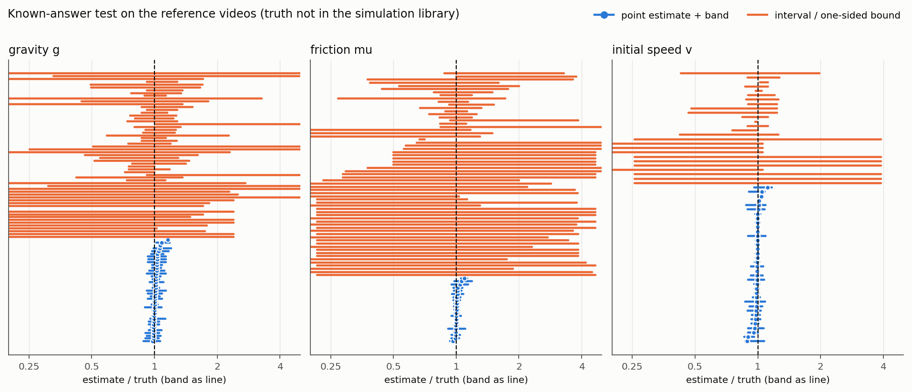
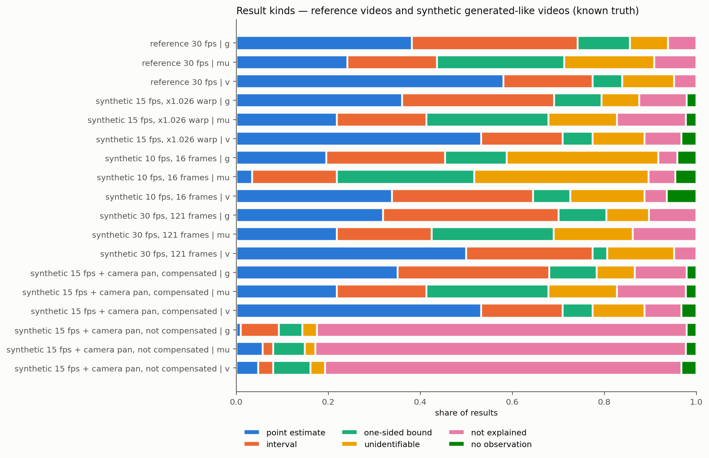
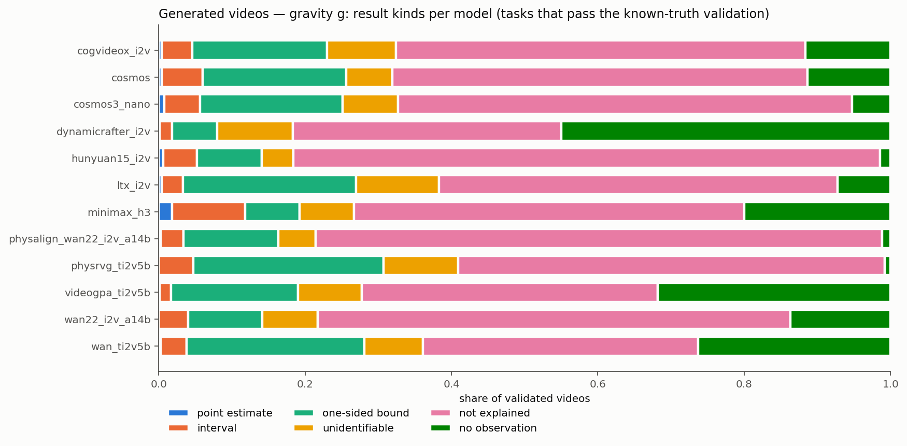
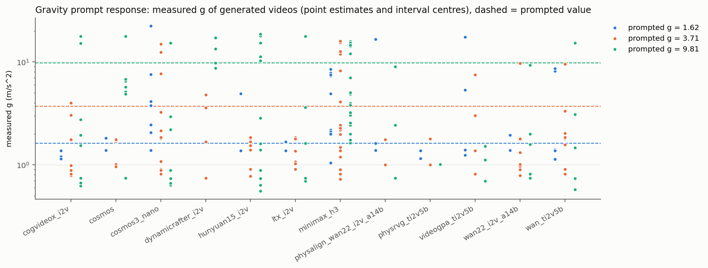

# PhysProbe 评测验收报告：Core100 物理参数反演

日期：2026-10-25 · 代码：`physprobe/inversion/`（分支 `physprobe-inversion`）· 运行手册：[physprobe/inversion/README.md](../../physprobe/inversion/README.md)

## 1. 结论

**评测做什么。**对 PhysEdit Core100 的每条视频（参考视频，或以第 5 帧为条件生成的视频），在其他条件全部已知的前提下，分别测量三个物理参数：
- 重力 g；
- 主接触面摩擦 μ；
- 初速度 v，只对有指定速度的 62 条任务。

做法是把视频里物体的运动，和作者原始 Genesis 场景在不同参数下的仿真逐帧比较。输出分以下几类：
- 点估计；
- 校准过的不确定区间；
- 单侧界；
- 不可辨识；
- 无法解释（任何参数值都解释不了视频里的运动）；
- 无观测（物体在窗口内大部分时间无法定位）。

**准确性。**在 97 条参考视频上做已知答案测试，真值不在仿真库里：

| 参数 | 点估计 | 点估计误差中位数 | 90 分位 | 真值落在不确定带内 |
|---|---|---|---|---|
| g | 35/97 | 1.4% | 6.2% | 85/96（89%） |
| μ | 20/87 | 0.7% | 6.2% | 75/85（88%） |
| v | 35/62 | 1.0% | 4.4% | 56/62（90%） |

- 不确定带使用理论噪声阈值(σ = 1.5 px,损失差 δ = 1),覆盖率已达到约 90%,不需要做经验放大。
- 没有给出点估计的情况,都给出了如实的区间或单侧界。这些多数是物理上确实测不准的情形:可预测窗口不到 0.3 秒、参数几乎不影响可见运动、真值附近存在分叉。

**生成视频路径同样准确。**把参考视频改造成"像生成视频"的合成视频,真值已知,走完整的生成视频流程:
- 15 fps、81 帧,外加 2.6% 的横向缩放:点估计误差中位数 g 1.2%、μ 0.9%、v 0.8%;
- 30 fps、121 帧:g 1.9%、μ 1.0%、v 0.8%;
- 10 fps、16 帧:g 1.6%、v 0.4%,但点估计少了近一半,其余是区间;
- 再叠加已知的镜头运动并做补偿:g 1.2%,和不加镜头运动时几乎一样;不补偿则 78/97 判为"无法解释"。

帧率换算、画面配准和相机运动补偿都没有引入可见的额外误差。

**合理性。**生成视频没有真值,用四类证据来检查:
- **跟踪噪声**:除 DynamiCrafter 外,生成视频上 SAM 框的逐帧抖动和真值视频同一量级(90 分位 ≤ 1.8 px)。
- **"无法解释"的含义**:它对应看得见的运动偏离:
  - 该动的不动,35%;
  - 动得不够,18%;
  - 轨迹不对,21%;
  - 动得过多,26%。
  
  其中 78% 的视频镜头配准完全正常,不是相机补偿的问题。
- **人工判读**:133 张叠加图。
  - "无法解释"的 43 张里,91% 确认是模型的物理错误或场景崩坏,0 张是跟踪失败;
  - 其余 90 张里,74% 合理,7% 拿不准,19% 不合理。不合理的主要是场景崩坏,其中一部分已被覆盖规则(D31)纠正,剩余约 11%,是这类指标的固有局限。
- **敏感性**:噪声容差加倍,模型排序基本不变(4.4 节)。

另外,真值视频本身也有少数(任务, 参数)给出"无法解释"(遮挡、叠放的书等),生成视频在这些地方不计分(真值验证门,挡掉 14%)。

**对生成视频的发现。**12 个模型、10,295 条视频、22,403 组计入统计的结果:
- 54.7% 无法解释:提示场景里任何参数值都解释不了视频里的运动;
- 14.7% 无观测:镜头或画面变化太大,或物体消失;
- 8.1% 不可辨识;
- 只有 22.6% 给出有信息量的估计,其中带包含提示值的只占 16.8%,即全部的 3.8%。

各模型在 1.8%(Hunyuan)到 5.6%(Cosmos3-nano)之间。物理完全正确、格式相同的合成视频,同样口径下约为 83%。

系统性的偏向是:物体滑得比提示的少(μ 偏大)、动得比提示的慢(v 偏小)。重力提示(月球 / 火星 / 地球)基本没有被遵循。

**速度。**
- 仿真库每个任务建一次,所有生成视频共用:约 8000 条仿真,在 7 张 GPU 上约 9 小时。
- 1 万条生成视频:SAM 3.1 跟踪约 7 小时(9 张 GPU),反演约 13 分钟(24 核)。全量重评测(参考、合成、生成)约 27 分钟。

## 2. 方法(对 99 条 Genesis 任务完全统一)

1. **仿真库。**每个(任务, 参数)建一个库,仿真用作者原始渲染脚本做纯物理重放,保持原始的 32 位设置。
   - g:绝对对数网格 0.5–25 m/s²,相邻比 1.12。
   - μ、v:真值 × 1.15^k / 1.12^k,另补两个半步。真值本身不进库,这样已知答案测试才是公平的。
   - 分叉区间再二分加密:相邻取值相差 ≥ 3%,而且两条轨迹差异超过运动幅度一半的地方,补上中点。
   - 合计 254 个库、8305 条仿真。每条只算到最后一个可预测窗口结束再加 31 帧。
2. **可预测窗口。**每个物体只在仿真本身能复现的帧段内参与比较。判据是:
   - 真值的多次重复之间、真值与记录之间,差异都小于 1.5 px;
   - 参数做 ±1e-4 扰动时,二阶差分也小于 1.5 px。
   
   所有库取值都用同一个窗口来比较。
3. **观测。**用 SAM 3.1(`sam3.1_multiplex.pt`)跟踪:
   - 一条视频里所有非固定物体在一次会话中联合跟踪;
   - 提示框是条件帧上物体可见部分的框。
4. **对齐。**
   - **时间**:按物理时间对齐。生成视频按播放速度计时(每帧 1 / 原生帧率),因为提示词只给物理量,没有要求慢放。允许 ±20 帧的连续时间平移,因为运动开始的时刻未知。
   - **像素**:每条视频把条件图配准到第 0 帧(ECC 仿射),纠正各模型的缩放和裁剪。
   - **相机运动**:每帧用背景配准回第 0 帧,补偿镜头运动。
5. **损失。**比较的是物体可见部分的框:用 Huber 残差,按条件帧框的对角线和噪声 σ = 1.5 px 归一化;各物体的损失相加;相邻库取值之间在参数空间插值(分叉区间不插值)。
6. **物体规则。**以下四条用来防止只靠次要物体或残缺的观测给出结论:
   - 物体在自己窗口内的视频帧里,有 SAM 框的不到一半(被遮挡、消失、画面崩坏),判为观测不足,不参与估计;
   - 在整个库里都拟合不上的物体,判为"无法解释";
   - 在联合最优点上和其他物体不一致的物体,判为"不一致";
   - 被拒的物体数不少于被采用的,或者参数的载体物体被拒(v 的速度物体、μ 的主接触运动物体),结果判为"无法解释"。
7. **估计。**损失在最小值 +1 以内的库取值都视为无法区分。
   - 它们的范围宽度不超过 ×1.25,给点估计;
   - 更宽,给区间;
   - 碰到网格一端,给单侧界;
   - 两端都碰到(或者只排除了另一端的最后一个网格值),判为不可辨识。
8. **真值验证门(只用于生成视频)。**如果真值视频(参考视频,或同一格式的合成视频)在某组(任务, 参数)上都没能给出估计,说明测量工具在这里解释不了正确的物理,生成视频在这组上的结果记为"未通过真值验证",不计入模型统计(3.2 节)。

## 3. 准确性证据

### 3.1 参考视频已知答案测试

图 1:每条参考任务的"估计值 / 真值"及不确定带。蓝色为点估计,橙色为区间或单侧界,虚线为真值。数据表见 [figures/tables.md](figures/tables.md)。

- g 最大的偏差是 T15_C05(+16%,而且带没有覆盖真值):真值附近笔记本电脑是否跌落会分叉;对 g 最敏感的地上手机,在参考视频里只有 23% 的窗口帧被 SAM 框到,按覆盖规则不参与估计,估计只能靠脚本驱动的书和笔记本电脑。97 条里只有这一条超过 10%。
- μ 和 v 超过 10% 的只有 T03_C01 的 v(−10.5%)和 T15_C02 的 v(+11.6%)。
- T19/T20 的 μ 不计入统计。支撑面是背景桌子,固定为 Genesis 默认摩擦 1.0,所以 μ < 1 在仿真里无法表示,只能判断 μ 是否大于 1。

### 3.2 生成视频路径(合成测试,真值已知)

**怎么造的。**从 97 条参考视频的条件帧(第 4 帧)起,每隔 STEP 帧取一帧,取够 N 帧,再给每帧加上 VideoGPA 实测的横向缩放(×1.026、偏移 −11 px)。这样得到三种格式的"生成式"视频,真值已知:
- s15v:15 fps × 81 帧,对应 15–16 fps 的 5 个模型;
- s30f121:30 fps × 121 帧,对应 24–25 fps 的 6 个模型;
- s10f16:10 fps × 16 帧,对应 DynamiCrafter。

它们走的是和真实生成视频完全相同的流程:配准、SAM 3.1 跟踪、相机补偿、评测。库里不含真值。

**结果**(T19/T20 的 μ 不计,见 3.1):

| 集合 | 参数 | 点估计 | 误差中位数 | 90 分位 | 真值在带内 |
|---|---|---|---|---|---|
| 参考视频(30 fps,原始) | g | 35/97 | 1.4% | 6.2% | 85/96(89%) |
| s15v | g | 34/97 | 1.2% | 3.9% | 80/93(86%) |
| s30f121 | g | 29/97 | 1.9% | 4.0% | 83/96(86%) |
| s10f16 | g | 19/97 | 1.6% | 7.1% | 80/91(88%) |
| 参考视频 | μ | 20/87 | 0.7% | 6.2% | 75/85(88%) |
| s15v | μ | 19/87 | 0.9% | 4.3% | 70/81(86%) |
| s30f121 | μ | 18/87 | 1.0% | 4.0% | 73/83(88%) |
| s10f16 | μ | 3/87 | 2.1% | — | 70/81(86%) |
| 参考视频 | v | 35/62 | 1.0% | 4.4% | 56/62(90%) |
| s15v | v | 33/62 | 0.8% | 4.7% | 52/59(88%) |
| s30f121 | v | 31/62 | 0.8% | 4.3% | 58/61(95%) |
| s10f16 | v | 19/62 | 0.4% | 2.0% | 52/56(93%) |

- 15 fps 和 30 fps 两种格式下,点估计的数量和精度都和原始参考视频相当。帧率换算(按物理时间对齐)和缩放配准没有引入可见的误差。

图 2:参考视频和各合成集合(含镜头运动测试)的结果类别分布。

- 16 帧(1.5 秒)的格式信息量小得多:μ 只剩 3 个点估计,g 也少了近一半,其余变成区间或"不可辨识"。点估计本身仍然准确,带的覆盖率也没有下降。DynamiCrafter 的结果主要是区间,这是格式本身的限制,不是方法的偏差。

**相机运动补偿。**在 s15v 上逐帧加一个已知的镜头运动(每帧平移 1.2 / 0.4 px,并以画面中心放大 0.2%;到第 80 帧累计平移 96 px、放大 16%),SAM 框也跟着同样移动:

| | g 点估计 | g 误差中位数 | g 真值在带内 | g 无法解释 |
|---|---|---|---|---|
| 不加镜头运动(s15v) | 34 | 1.2% | 80/93 | 12/97 |
| 加镜头运动,用背景配准补偿 | 33 | 1.2% | 78/92 | 13/97 |
| 加镜头运动,不补偿 | 1 | 53% | 9/53 | 78/97 |

补偿后几乎完全恢复到没有镜头运动时的结果(μ、v 同样如此:点估计 19 / 33 个,误差中位数 0.8% / 0.9%)。不补偿时,镜头运动被当作物体运动,大部分结果变成"无法解释"。

**真值视频上的"无法解释"。**物理完全正确的视频,也有少数(任务, 参数)给出"无法解释":参考视频 g 7/97、μ 9/87、v 4/62,合成视频略多(s15v 的 g 12/97)。原因都在测量一侧:
- T16_C02–C04:文件夹被遮挡,或者下游箱子的 SAM 框偏了;
- T18_C01/C02/C05:叠放的书大多跟不准;
- T10_C01、T15_C03:三个物体里有两个"不一致";
- 合成视频上的 T13:降到 12 fps 后,驱动书拟合不上。

所以这些(任务, 参数)上的生成视频,"无法解释"并不说明模型的物理错了。处理办法是**真值验证门**(问题记录 D28):参考视频,或同一格式的合成视频,只要有一个在某组(任务, 参数)上没给出估计,这组在该格式下的生成视频结果就记为"未通过真值验证",不计入模型的统计。生成视频的结果中,被门挡掉的占 14%(按格式和参数在 6–21% 之间,详见第 5 节)。

门是用这些真值视频定出来的,所以门内的误报率不能再用同一批视频来估计。能做的是跨格式检验:只用参考视频做门时,s15v 上还剩 g 5/90 条误报(T13 ×3、T15_C03、T18_C03),这些正是同格式门要挡掉的那类情况。生成视频上的残余误报,靠第 4 节的人工判读来估计。

### 3.3 观测精度(SAM 3.1)

在 5 条 pilot 参考视频上,把 SAM 框和真值可见框比较:

| 物体(示例) | V4 前端(窗口内 90 分位误差) | 精简联合跟踪 |
|---|---|---|
| T03 撞击书 | 3.8 px | 4.7 px |
| T11 驱动橡皮 | 4.1 px | 4.1 px |
| T18 book_05 | 17.0 px | 2.3 px |
| T18 book_04 | 28.3 px | 11.7 px |

两边都跟踪的物体,中位误差相差不超过 0.5 px;叠放的书,联合跟踪明显更好。精简版在 H100 上每条视频 25–40 秒,V4 前端每个物体约 5 分钟。

### 3.4 仿真一致性

- **换机器**:14 条代表性任务在每台新的评测机上用真值重放,并把这次重放当作又一次真值重复,加进可预测窗口的计算:
  - 确定性任务全程差 ≤ 0.25 mm;
  - 混沌任务(T13)和 4090 上几次重复的分歧时刻落在同一分布里。
- **截断**:每条仿真只算到窗口结束。17 个任务家族里,确定性任务在保留的帧内和完整版逐帧一致(0.0 mm)。
- **MPS 并发**:开 MPS 后同卡多进程并发,单卡吞吐提高到原来的 6–16 倍,结果同样通过上面的一致性检查。

### 3.5 阈值校准

对每条参考结果,计算让真值落进带内所需的最小阈值:
- 237 组结果中,中位数 0.05,90 分位 0.64;
- 理论阈值 1 的覆盖率为 93%。

所以噪声模型(σ = 1.5 px,各帧独立)本身就是校准良好的,不需要经验放大。

## 4. 合理性证据

生成视频没有真值,所以合理性只能从三方面来看:
- 观测本身靠不靠得住;
- "无法解释"对应的是不是看得见的运动偏离;
- 人工判读的结论和自动结论是否一致。

### 4.1 生成视频上的跟踪噪声

噪声模型假设 SAM 框每条边有 σ = 1.5 px 的独立噪声。生成视频的画面会抖、会变形,如果实际噪声明显更大,"无法解释"就会被高估。

测量方法:在可预测窗口内,对每个物体取框边的二阶差分,算它的稳健标准差。白噪声二阶差分的标准差是 √6 σ,平滑的运动几乎不贡献。

| 视频 | 每个物体噪声的 90 分位 |
|---|---|
| 合成视频(真值已知,15 / 30 / 10 fps) | 0.6 / 0.3 / 0.85 px |
| 生成视频,除 DynamiCrafter 外的 11 个模型 | 0.2–1.8 px |
| 生成视频,DynamiCrafter | 4.3 px |

除 DynamiCrafter 外,生成视频上的逐帧噪声和合成视频同一量级,都在 σ = 1.5 px 附近或以内。所以"无法解释"不是跟踪抖动造成的。按门限,它对应的是框边平均偏离约 7 px 以上的成片偏差。

DynamiCrafter 只有 10 fps,画面变形严重,噪声偏大,它的结论要谨慎看待(见第 6 节)。

### 4.2 "无法解释"对应的是什么

"无法解释"的意思是:在提示的场景里,无论参数取库中哪个值、时间怎样平移,视频里的运动都对不上仿真(某个物体的最优损失 > 10,约等于四条框边平均偏 7 px 以上),或者多数物体互相矛盾。下面三项检查说明,它对应的是看得见的运动偏离,而不是测量的副作用。

**运动幅度。**`motion_check.py` 把每个"无法解释"结果里物体的实际最大位移,和提示值下仿真的最大位移相比(只统计提示场景里物体应当移动 ≥ 10 px 的情形,共 13,042 个):

| 观测位移 / 仿真位移 | 占"无法解释"的比例 | 含义 |
|---|---|---|
| < 0.25 | 35% | 该发生的运动几乎没发生(书不滑、多米诺不倒、罐子不滚) |
| 0.25–0.67 | 18% | 动得明显不够 |
| 0.67–1.5 | 21% | 幅度相当,但方向、时间或轨迹不对 |
| > 1.5 | 26% | 动得过多:跳动、飞出、凭空运动 |

物理正确的合成视频上,"几乎不动"的比例是 0。不同模型的特征很鲜明:PhysRVG 的"无法解释"里 86% 是几乎不动,CogVideoX、LTX、Wan-TI2V 约 60%;MiniMax 55% 是动得过多,Wan2.2 和 PhysAlign 约 40%。

**相机。**"无法解释"的视频里 78% 背景配准全程正常,没有大的镜头运动;所以它基本不是相机补偿的问题。相机补偿本身在合成视频上做过已知答案测试(3.2 节)。

**起动时刻。**提示词没写运动从什么时候开始,评测允许 ±20 帧(0.67 秒)的时间平移。实测"观测起动 − 仿真起动",在 T16–T20 的"无法解释"里只有 3–21% 超出这个范围;只有 T11 例外(仿真里 2.0 秒才推,生成视频平均早 1.4 秒),所以 T11 的"无法解释"可能部分来自起动时间未指定(问题记录 D29)。

**"无观测"的来源。**过门后 14.7% 的结果是"无观测",即物体在窗口内一半以上的帧里无法定位。其中 84% 来自背景配准在 30% 以上帧里失败的视频:镜头大幅移动、拉近,或者画面整体变成别的场景,物体位置已无法和固定机位的仿真比较。其余 13% 是物体被遮挡、消失或跟丢。

### 4.3 人工判读

`qa_overlay.py` 按"模型 × 结果类别"分层抽样,每张叠加图取窗口内的 8 帧,画出三种框:
- 绿:SAM 框;
- 红:提示值下的仿真;
- 蓝:最佳拟合。

逐张判读,共 133 张:最终结果的抽样 114 张,另有修正 D30 之前抽到的"无法解释" 19 张。判读记录在 `.local-research/evaluation/qa_view/qa_review_final.jsonl`。

**"无法解释"(43 张)**

| 判读 | 张数 |
|---|---|
| 模型的物理确实错了,SAM 跟踪正确 | 32 |
| 场景崩坏(有手伸进来、镜头飞到别的房间、物体凭空出现) | 7 |
| T11:起动时间未指定,窗口内看不到推的动作 | 3 |
| 镜头大幅平移,拿不准 | 1 |
| SAM 跟丢 | 0 |

39/43(91%)确认是模型的问题,没有一例是跟踪失败造成的。第一轮(D30 之前)的 18 张里有 1 张是外观突变导致跟丢,合计约 1/60。

**点估计、区间、单侧界(90 张)**

| 判读 | 点估计 18 | 区间 24 | 单侧界 48 | 合计 90 |
|---|---|---|---|---|
| 合理:估计方向和画面一致(书滑得少 → μ 偏大,倒得慢 → g 偏小) | 8 | 10 | 7 | 25 |
| 合理:物体根本没动,结果落在让它静止的网格一端 | 3 | 12 | 27 | 42 |
| 拿不准 | 3 | 1 | 2 | 6 |
| 不合理 | 4 | 1 | 12 | 17 |

不合理的 17 张里:
- 14 张是场景崩坏:物体被凭空出现的东西带着走、桌子翻转、镜头飞走;
- 2 张是 DynamiCrafter 第 0 帧不是条件图,提示框落错了位置;
- 1 张是镜头拉近太多,没有补偿干净。

这促成了覆盖规则 D31。按最终规则重画后,其中 7 张已经纠正:5 张改判"无观测",1 张改判"无法解释",1 张改判"不可辨识"。剩下 10 张(占 90 张的 11%)是 SAM 一直跟着物体、但物体在做幻觉运动,而这种运动又碰巧和某个参数值的仿真吻合,例如杯子被凭空长出的书塔托起,得到 v = 7.6 m/s。这是"在给定场景里拟合一个参数"这类指标的固有局限,第 6 节有说明。

**"物体没动"这一类要特别注意解读。**在 T06(书本多米诺)、T09(书堆)、T12(订书机)这类任务里,模型常常让该倒、该滑的东西完全不动。评测会给出"g 接近网格下限""μ ≥ 某个大值"之类的结果:在物理上这是自洽的,弱重力或大摩擦确实会让物体在窗口内看起来不动。但它的实际含义是"提示的事件没有发生",而不是"模型模拟了另一种重力或摩擦"。`motion_check.py` 的 `static` 标记可以把这类结果单独挑出来。

### 4.4 噪声假设的敏感性

把噪声 σ 从 1.5 px 加倍到 3 px,相当于把所有容差放宽一倍,用 `tools/evaluate_variant.sh` 对参考、合成、生成三组视频全部重跑,结果见 SENSITIVITY 段落。

## 5. 生成视频结果

**规模。**12 个模型 × 97 个任务 × 3 种提示词 × 3 个种子,共 10,295 条视频,得到 27,164 组(视频, 参数)结果。处理如下:
- T19/T20 的 μ 不计;
- 真值验证门挡掉 3,756 组(14%);
- 剩下 22,403 组计入统计。

图 3:按模型的结果类别,只统计通过真值验证门的结果(g;μ、v 的图在 `figures/fig3_generated_mu.png`、`fig3_generated_v.png`,全部数据表见 [figures/tables.md](figures/tables.md))。

**总体。**22,403 组结果的分布:

| 类别 | 占比 |
|---|---|
| 无法解释 | 54.7% |
| 无观测(物体无法定位,主要是镜头或画面变化太大) | 14.7% |
| 不可辨识 | 8.1% |
| 有信息量的估计(点估计、区间、单侧界) | 22.6% |
| 其中带包含提示值的 | 3.8%(占有信息量估计的 16.8%) |

作为对照,同一格式、物理完全正确的合成视频,同样口径下有信息量估计与真值一致的占 83–84%(16 帧格式 62%)。这个对照是在门内算的,门又是用这些合成视频定的,所以略偏乐观;但有信息量的估计里 97–98% 与真值一致,这一点不受门的影响。所以低分不是测量工具的上限造成的。

**按模型**(三个参数合计,按"与提示一致"排序):

| 模型 | 计入统计 | 无法解释 | 无观测 | 不可辨识 | 有信息量的估计 | 其中与提示一致 | 与提示一致 / 全部 |
|---|---|---|---|---|---|---|---|
| Cosmos3-nano | 1944 | 59% | 5% | 7% | 28% | 20% | 5.6% |
| LTX | 1944 | 50% | 7% | 12% | 31% | 17% | 5.3% |
| PhysRVG | 1863 | 53% | 1% | 11% | 35% | 13% | 4.6% |
| CogVideoX | 1863 | 54% | 11% | 10% | 25% | 16% | 4.1% |
| Wan-TI2V-5B | 1874 | 36% | 26% | 8% | 29% | 14% | 3.9% |
| VideoGPA | 1944 | 38% | 32% | 8% | 22% | 18% | 3.9% |
| DynamiCrafter | 1800 | 35% | 45% | 9% | 11% | 34% | 3.8% |
| Wan2.2-I2V-A14B | 1863 | 65% | 14% | 7% | 14% | 26% | 3.7% |
| Cosmos | 1863 | 56% | 12% | 7% | 25% | 13% | 3.4% |
| MiniMax | 1638 | 52% | 21% | 7% | 19% | 17% | 3.4% |
| PhysAlign | 1863 | 77% | 1% | 7% | 15% | 12% | 1.9% |
| Hunyuan | 1944 | 79% | 2% | 5% | 15% | 12% | 1.8% |

- 没有一个模型能稳定地按提示的物理量生成运动:与提示一致的比例都在 2–6%。
- 模型之间的差别主要在"怎么错":
  - Hunyuan、PhysAlign、Wan2.2 的运动 65–79% 无法解释,其中 PhysAlign、Wan2.2 约 40% 是动得过多;
  - PhysRVG、CogVideoX、LTX 多数是该动的不动;
  - VideoGPA、Wan-TI2V、MiniMax、DynamiCrafter 有大量"无观测",镜头和画面变化太大。
- DynamiCrafter 只有 16 帧,84/97 的视频第 0 帧已不是条件图,跟踪噪声也明显偏大。它"有信息量估计中与提示一致"的 34% 主要来自很宽的带,不能和其他模型直接比较。

**偏离的方向。**只看有不确定带的结果(点估计、区间、单侧界、不可辨识),带整体在提示值哪一侧:
- μ:带整体高于提示值的占 47–61%(DynamiCrafter 34%),低于的几乎没有(0–8%)。生成视频里物体滑得比提示的少。
- v:带整体低于提示值的占 43–74%,高于的 0–10%。物体动得比提示的慢。
- g:低于、包含、高于大约各占三分之一。在倒塌、滑落类任务里,"g 偏低"多数是事件没有发生(4.3 节)。

**重力提示响应。**C01/C02/C03 分别提示月球、火星、地球重力(1.62 / 3.71 / 9.81 m/s²)。只取点估计和区间中心,12 个模型里有 10 个在三种提示下测出的 g 中位数都在 0.7–2.2 之间,和提示无关(MiniMax 和 DynamiCrafter 的样本少且离散),见图 4 和 `results_gen/all_cc_gated_by_model.md`。不过每格只有 4–23 个样本(大多数结果是"无法解释"或单侧界),只能作为定性结论。

图 4:C01–C03 的测量 g(点估计和区间中心),虚线为提示值。

## 6. 局限

- **参数拟合指标的固有局限。**评测回答的是"在提示的场景里,哪个参数值能解释视频里的运动"。生成视频里如果物体被幻觉出来的东西带着走,而这种运动又碰巧和某个参数值的仿真吻合,评测会给出一个估计,但这个估计没有意义。非"无法解释"的判读样本里约 11% 属于这种情况(4.3 节)。要彻底排除,需要另加场景一致性检查,例如检测凭空出现的物体,或者用 VLM 判读;这不在本次范围内。
- **"物体没动"给出的是网格端点的值。**这在物理上是自洽的,但实际含义是"事件没发生"(4.3 节)。报告模型的重力或摩擦时,应和 `motion_check.py` 的静止标记一起看。
- **"无法解释"的绝对比例取决于容差。**σ 加倍后会明显下降,但模型排序稳定(4.4 节)。正式结果用的 σ = 1.5 px 是在真值视频上校准过的(3.5 节)。
- **窗口很短的任务**:可预测窗口不到 0.3 秒的任务(T14 等,以及 T04_C03/C04 的部分物体),多数只能给出区间或"不可辨识"。
- **T19/T20 的 μ**:只能判断是否大于 1(背景桌子固定为 1.0)。要改作者加载背景的代码,才能测更低的值。
- **T11**:提示词没写起动时间,仿真里 2.0 秒才推;生成视频的"无法解释"可能部分来自时间未知。
- **T06_C04**:用 Isaac 仿真,按决定跳过,所以共 99 条任务。
- **DynamiCrafter**:只有 16 帧(1.5 秒),84/97 的视频第 0 帧已不是条件图,配准只能用模型的中位映射,有的视频提示框落错了位置,跟踪噪声也偏大。它的结果单列,不和其他模型直接比较。
- **被门挡掉的 14%**:测量工具在这些(任务, 参数)上解释不了正确的物理(遮挡、叠放的书、两个物体时的多数规则),生成视频在这里不计分。
- **未经确认的事项**:
  - E1:T02/T16 主接触面的另一种对应方式;
  - 生成视频按实时计时(E2),这个是我按提示词内容做的决定。

## 7. 复现

- **代码**:分支 `physprobe-inversion` 下的 `physprobe/inversion/`。完整流程和命令见 [README](../../physprobe/inversion/README.md)。
- **数据**:仿真库、SAM 轨迹和结果在 `PHYSPROBE_WORK` 下,不进 git;服务器镜像在 Storage01 的 `zhangshuran_eval_20261024/PhysProbe`。
- **全量重评测**:`bash physprobe/inversion/tools/reevaluate_all.sh <镜像根目录> 24`。依次做以下步骤,在 h100-1 上约 27 分钟:
  - 参考视频;
  - 阈值校准;
  - 生成视频;
  - 合成视频和镜头运动测试;
  - 真值验证门、汇总、图表。
- **后处理**:`tools/postprocess_generated.sh <镜像根目录> all_cc 24`,包括门、汇总、运动幅度和起动检查、敏感性对比、图表。
- **规则变体对比**:`VAR=VALUE tools/evaluate_variant.sh <镜像根目录> TAG`,例如 `PHYSPROBE_SIGMA_PX=3`。
- **跟踪噪声**:`track_noise.py`。
- **人工判读**:`qa_overlay.py`,判读记录在 `.local-research/evaluation/qa_view/`。
- **问题与决策记录**:`.local-research/evaluation/CORE100_INVERSION_ISSUES.md`,编号 A–F,本报告涉及 D7–D32、C12–C14、E2 等条目。
